# Holistic Review: architecture

Status: approved architecture, implementation in progress. The implementation follows the milestones in [docs/plan/README.md](plan/README.md).

Holistic Review is a hosted, multi-tenant web application. A developer signs in, connects repositories, and reviews a full codebase at one pinned commit. A repository comes from the Holistic Review GitHub App, or from a local directory that the instance mounts read-only. The developer writes change requests on lines, line ranges, symbols, or files. The developer's coding agent runs next to the developer's local clone and connects to the application's MCP endpoint. The agent discusses a request in its thread, or does the work, links each commit to the requests that it covers, and marks requests ready for review. The developer verifies or reopens each request in the web UI.

Related documents:

- [Requirements](requirements.md): the problem, the principles, the functional requirements, the non-goals, and the standing rules.
- [Specifications](specs/README.md): the REST API, the MCP server, webhooks and live updates, and the JSON Schemas. They are the source of truth for every contract.
- [Implementation plan](plan/README.md): the milestones, the workflow, and the setup gotchas.
- [Backlog](backlog/README.md): work outside the proof of concept.
- [User documentation](user/index.md) and the [Agent Skill](user/skill/SKILL.md).
- [Tool findings](architecture/tool-findings.md): Step 1, per tool, read from source.
- [Spike results](architecture/spike-results.md): Principle B, per component, with requirement tables.
- [Stack findings](architecture/stack-findings.md): MCP SDK, Agent Skills, versions, git plumbing.
- Screenshots: [architecture/](architecture/). The spike code stays in the phase 1 scratch directory. It is not part of the repository.

| Term | Meaning |
|---|---|
| Tenant | One developer account and all its data. A tenant never sees the data of another tenant. The proof of concept has one user per tenant. `User` and `Tenant` are separate tables. |
| Instance | One deployment of Holistic Review with its own configuration |
| Repository | A git repository that a tenant connected. Its source is a GitHub App installation or a local directory under `APP_LOCAL_REPOSITORIES_DIR`. |
| Server clone | The bare clone that the server keeps for each repository and fetches from the source. A commit in it is available. |
| Review | One review round of one repository, pinned to one revision: a commit SHA. Several open reviews of one repository are fully separate. |
| Request | One change request, or feedback unit: a thread that asks for one change |
| Batch | Draft requests and replies that the user submits together |
| Anchor | Where a request points at the review commit |
| Location | Where the anchor is found at another commit |
| Actor | The user, an agent that acts for the user, or the system |

## 1. Findings from Step 1

| | Batch Review | CodeReview.json | difit | GitHub orphan-branch PR |
|---|---|---|---|---|
| Version read | `831d427`, 1.3.0 | `df806b5`, 0.0.2 | `82a765c`, 5.0.12 | Docs and schema, 2026-09 |
| Storage | Process memory. JSON array and Markdown written on explicit save. No SHA, no lock, not atomic. | `.review/<name>.log.jsonl` append-only events, `.view.json` projection, `state.json` | Browser localStorage and server memory. Lost after a restart on another port. | GitHub PR review threads |
| Data model | `Comment {id, file_path, line_start, line_end, reference, text, highlighted_text, region fields, created_at, outdated}` | `add_thread {id, file, range, snapshot, author, body, ts}`, `reply`, `resolve`, `reopen`, `edit_comment` | `DiffCommentThread {id, filePath, position {side, line}, codeSnapshot, messages[]}` | `PullRequestReviewThread {isResolved, isOutdated, path, line, originalLine, subjectType, comments}` |
| Anchoring | Compare the text at the stored lines with the snapshot. No relocation. | Exact block at stored lines, else nearest exact block, else outdated. No whitespace tolerance, no git. | Snapshot compare inside one diff. No relocation. | Follows unchanged lines. A changed line makes the thread outdated with `line = null`. |
| Lifecycle | None. Done means deleted. | `open`, `resolved`. No actor on resolve. | None. Resolve deletes the thread. | Resolved or unresolved, plus outdated. |
| Agent interface | 20 MCP tools, REST, CLI with JSON on stdout. Reviewer skill only. | `SKILL.md` with `jq` reads and `>>` appends. No CLI, no MCP. | Copy-as-prompt `path:L40-L46`, CLI `comment get/add/resolve`. No MCP. | GraphQL, REST, official GitHub MCP server |
| UI | React 18, Monaco from a CDN, comments as side-panel cards | VS Code Comments API | Own table renderer, Prism per line | The reference UX |
| License | MIT | MIT | MIT | Not applicable |

Reuse decisions:

- **Batch Review:** ideas only. Keep the path check on every write. Do not copy the Python code, the memory-only storage, or the open CORS policy. Its claimed gaps: "no lifecycle" and "not GitHub-like" are correct. "Line-range anchors only" is partly wrong, because file and document-region anchors exist.
- **CodeReview.json:** ideas only. Keep the event log with one pure reducer, "outdated" as a derived flag, and the nearest-match search as one fallback step. Do not copy positional comment IDs: they break after a git merge that changes the event order, and the study proved this. Do not let the agent write raw events.
- **difit:** ideas only. It has no whole-file mode, and its components are internal to the app: 31 files and 4,258 lines with hardcoded API paths. Copying and adapting them is the same as writing our own viewer, which Principle B forbids. Keep the `path:Lx-Ly` location format and the index of viewed files.
- **GitHub orphan-branch PR:** the UX reference and the state vocabulary, not the product. A PR shows at most 20,000 diff lines or 1 MB, and 300 to 3,000 files. The Symfony skeleton alone uses 66% of the line budget. All code must go to GitHub, and every agent commit needs `[skip ci]`. GitHub has only two thread states. Its resolution reasons ADDRESSED, WONT_FIX, and INVALID apply to Copilot threads only.

What the design takes from all four:

1. An append-only event log with an actor on every event, reduced by one pure function.
2. An original anchor that never changes, plus a location that is computed per target, like GitHub's `originalLine` and `line`.
3. "Outdated" is a derived flag. It never changes the lifecycle state.
4. Explicit states between "open" and "resolved", because the agent workflow needs them.
5. A pending review that the human submits as one batch, so the agent never starts on a half-written review.
6. A validating MCP server for the agent. The agent never edits review data directly.

## 2. UI component spikes and the selected component set

Each spike rendered two unchanged files: Symfony `Command.php` with 733 lines, and Doctrine `UnitOfWork.php` with 3,534 lines. Tests used real mouse events through puppeteer-core and headless Chrome. `@pierre/diffs` was not in the brief. I added it because it has a file view that is not a diff.

| Requirement | `@git-diff-view/react` 0.1.7 | `react-diff-view` 3.3.3 | `@pierre/diffs` 1.5.1 | difit 5.0.12 |
|---|---|---|---|---|
| R1 full unchanged file | Workaround. Identical content gives 0 lines (issue #16, "wontfix"). An 11-line hand-built hunk fixes it. | Yes, `textLinesToHunk` | Yes, native `File` and `CodeView` | No. Lines show as added, or a change is necessary. |
| R2 one line-number column | CSS override of internal markup | Yes, in an undocumented layout mode | Yes, native | No, two columns |
| R3 PHP highlighting | lowlight. Highlighting stops without warning above 2,000 lines. | refractor 5 needs a 3-line adapter. The types do not catch a wrong adapter. | Shiki 4.4.3 with GitHub themes | Prism per line. Docblocks get wrong colours. |
| R4 hover "+" | Native | Own button in `renderGutter` | Native | Speech-bubble icon |
| R5 widget below the line | Native, one at a time | Native `widgets` | Native annotation slot | Native |
| R6 drag and shift-click range | Native drag loses the range (2 bugs). No shift-click. 35 lines of glue. | Not native. 91 lines of glue. | Native gestures. 25 lines of glue open the widget. | Native, inside one hunk only |
| R7 programmatic range | 9 lines | 15 lines: 9 for the range, 6 for the scroll | Native `selectedLines` and `scrollTo` in `CodeView` | Not tested |
| R8 several threads, any React | Yes | Yes | Yes. Primer components work inside. | Two inline threads, own UI only |
| R9 3,534-line file | 0.5 s. No virtualization. 100-130 ms per interaction. | 0.42-0.47 s. No virtualization. | Virtualized. First rows in 41 ms, 0 main-thread long tasks with workers. | 0.44 s, 186,662 DOM nodes |
| R10 GitHub look | Built-in themes | 348 lines of our own CSS | Shiki GitHub themes and CSS variables | Own theme |
| Glue code | 77 lines | About 175 lines and 348 lines of CSS | About 72 lines | Not reusable |
| Library JS, gzip | 336 kB, of which highlight.js 299 kB | 34 kB with PHP grammar | 115 kB, or 175 kB with `CodeView`, plus 87 kB lazy PHP grammar | Not a library |
| License | MIT | MIT | Apache-2.0 | MIT |
| Maintenance | 527 of 530 commits by one person, 0.1.x | Last releases 2025-07 and 2026-03 | 63 versions in 6 months. Breaking changes ship in minor versions. | Active app |

`@primer/react` is not a code viewer. Its spike built the surrounding GitHub UI: file tree, file header with "Viewed", thread boxes with state labels, reply box, "Finish your review" overlay, and the request list. It has no public comment-thread box, Markdown editor, or Markdown renderer. GitHub keeps those internal.

### Selected component set

| Part | Package | Why |
|---|---|---|
| File view | `@pierre/diffs` `CodeView` | Only candidate with a native full-file view, native range gestures, and virtualization |
| Fix diff in the verify view | `@pierre/diffs` `FileDiff` | Same library, same look |
| Tree, buttons, menus, labels, overlays, table | `@primer/react`, `@primer/primitives`, `@primer/octicons-react` | GitHub's own design system |
| Comment bodies | `react-markdown` with `remark-gfm`, styled by `markdown.css` from `@primer/css` | Secure by default: it escapes raw HTML and drops `javascript:` URLs |
| Framework and build | React 19, TypeScript 7, Vite 8 through Symfony Reprise | `@primer/react` is a React library, and `@pierre/diffs` has React bindings. AssetMapper cannot compile JSX. Reprise is Symfony's own Vite integration. |

The smallest adaptation for `@pierre/diffs`, from the spike, is about 72 lines:

1. Strip the trailing newline with the public `cleanLastNewline()`. Otherwise a phantom last row shows.
2. Wait for the annotation slot before focus and scroll: 28 lines.
3. Clear the selection after submit or cancel: 15 lines. While a selection exists, the "+" stays on its last line and does not follow the mouse. This is gap G1.
4. Find the bottom line of a range in both drag directions: 6 lines.
5. Put all threads of one line into one annotation, because slot names are per line: 11 lines.
6. Keep the annotations array identity stable. Otherwise each keystroke re-renders the file, which cost 108 ms per key on the large file: 2 lines.
7. Wrap annotation content in Primer `BaseStyles`. Otherwise widgets inherit the code font.

The thread box is composed from public Primer parts: Avatar, RelativeTime, Label, ActionMenu, ActionList, IconButton, Textarea, and Button, with CSS Modules for the layout. See decision D2.

| | |
|---|---|
| 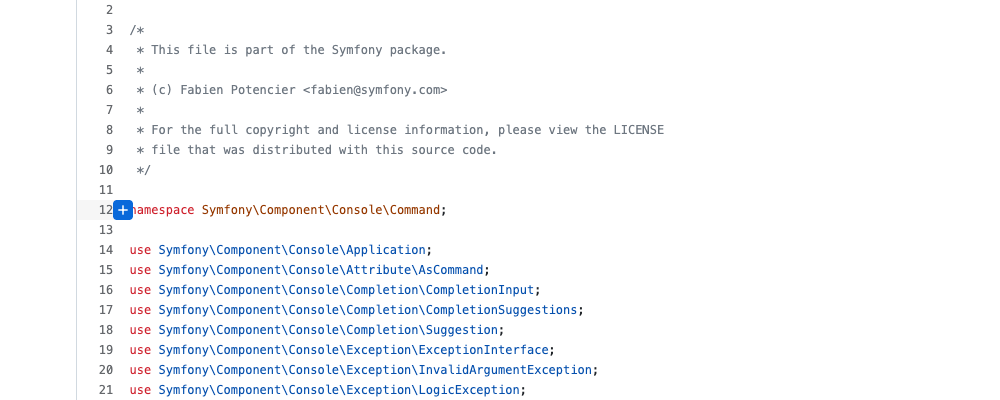 `@pierre/diffs`: native "+" on hover | 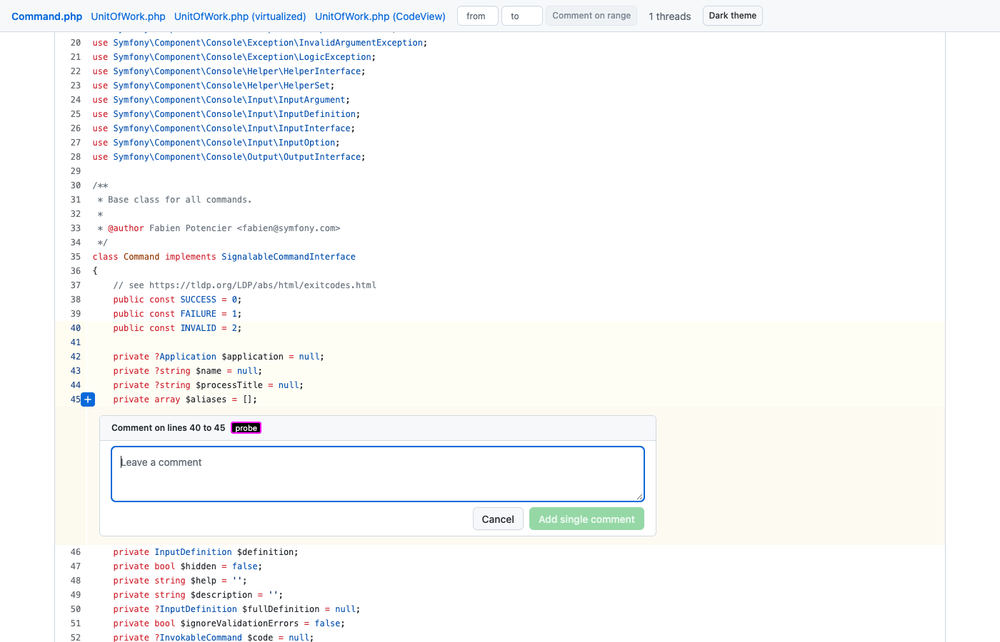 `@pierre/diffs`: drag range, box below the last line |
| 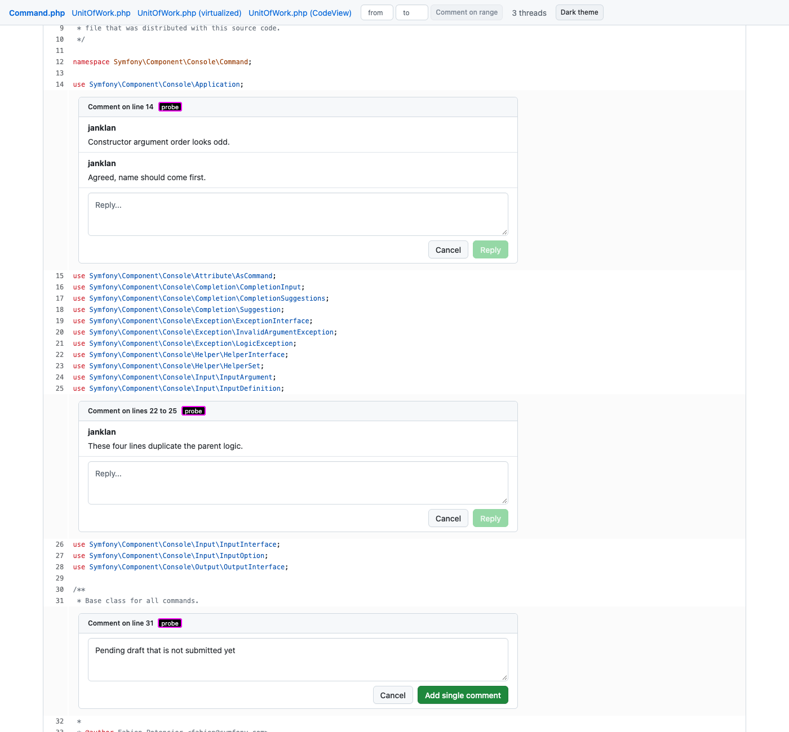 `@pierre/diffs`: several threads with Primer buttons | 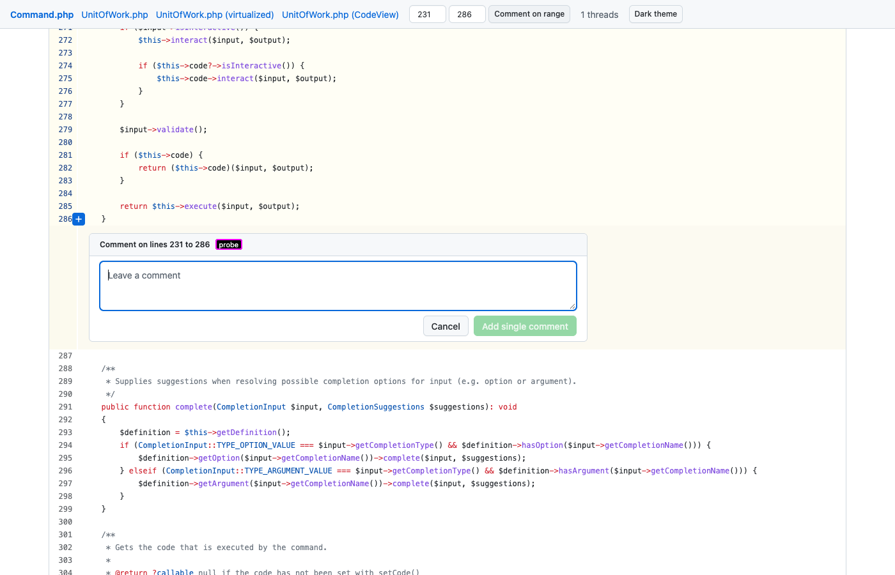 `@pierre/diffs`: programmatic range of `run()`, lines 231-286 |
| 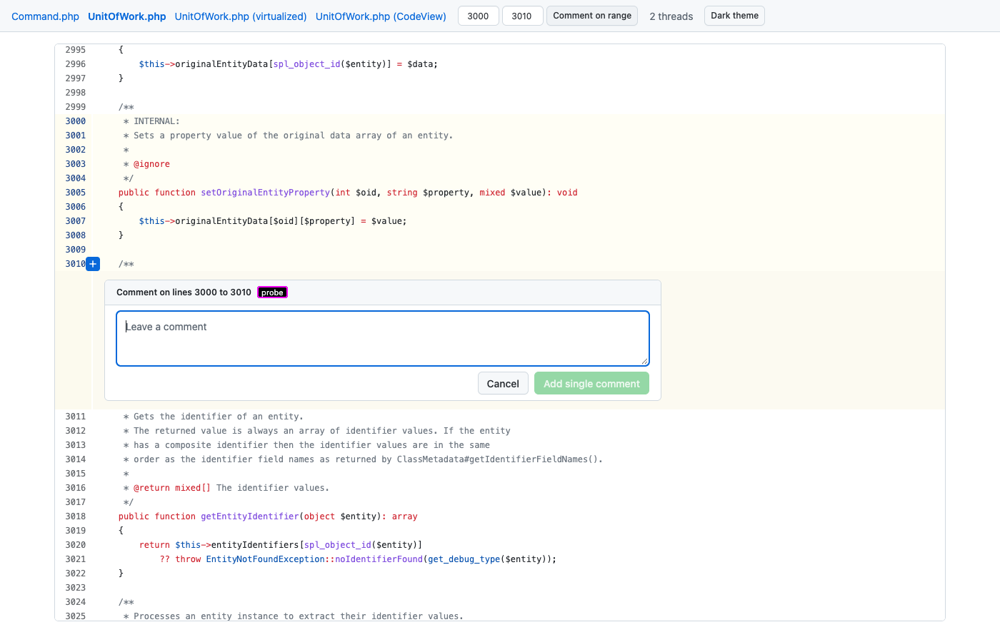 `CodeView`: range 3000-3010 in the 3,534-line file | 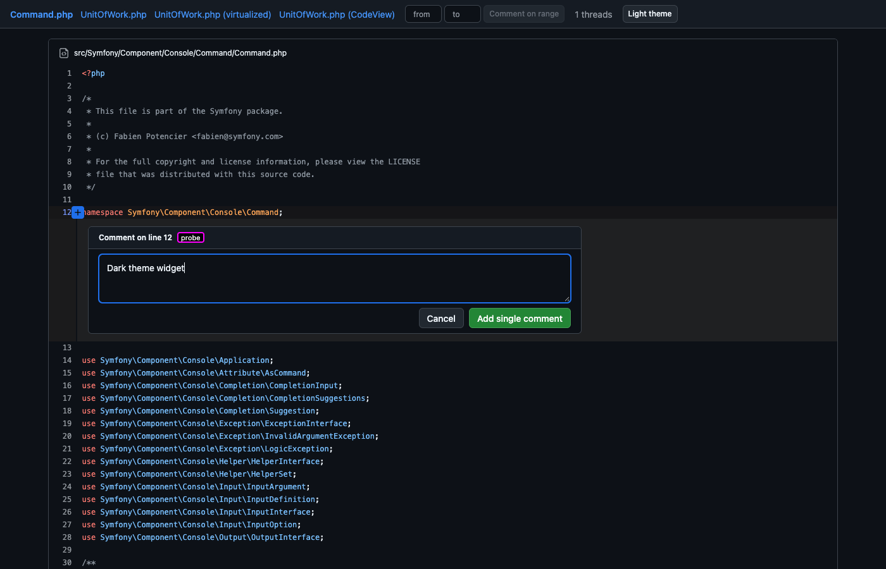 `@pierre/diffs`: dark theme |
| 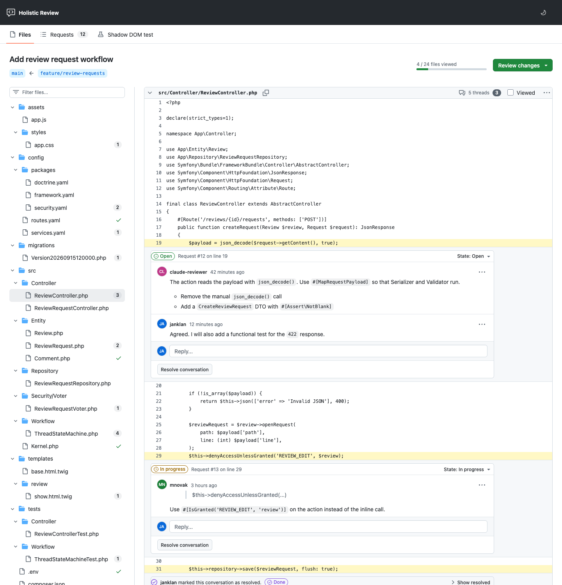 Primer: tree, file header, thread with state label | 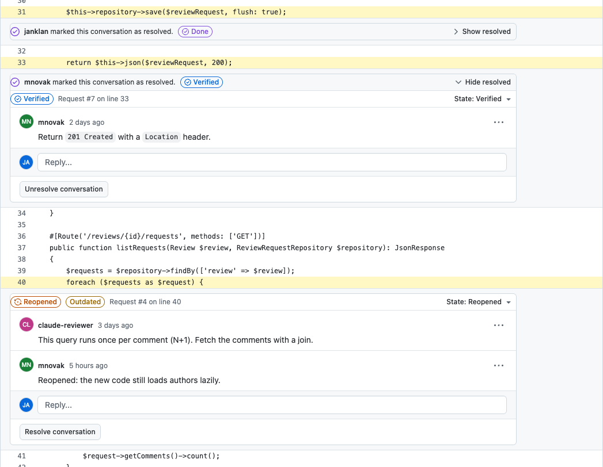 Primer: resolved, reopened, and outdated threads |
| 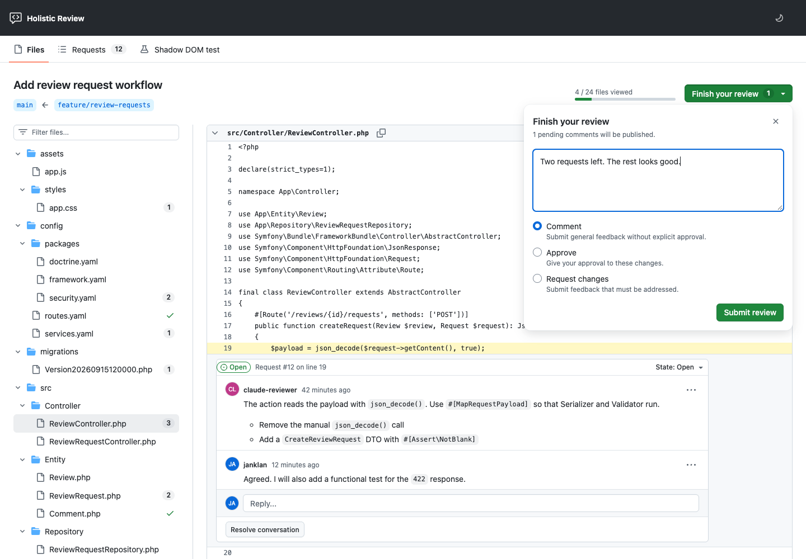 Primer: "Finish your review" overlay | 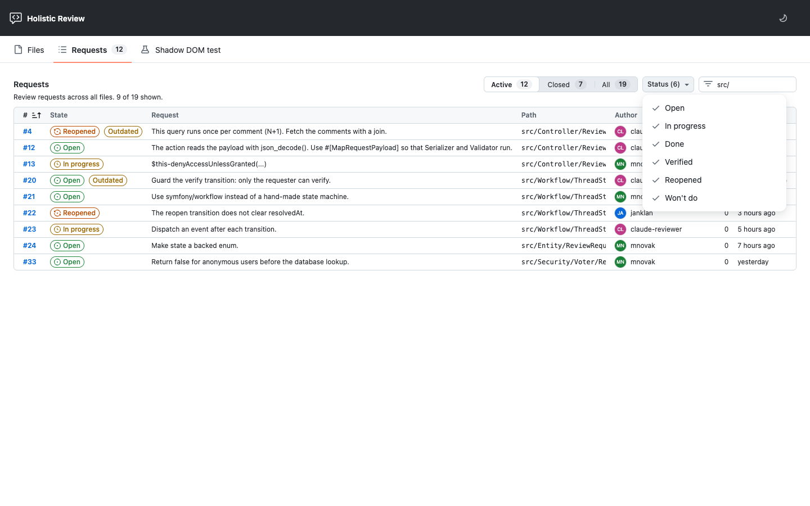 Primer: request list with status filter |
| 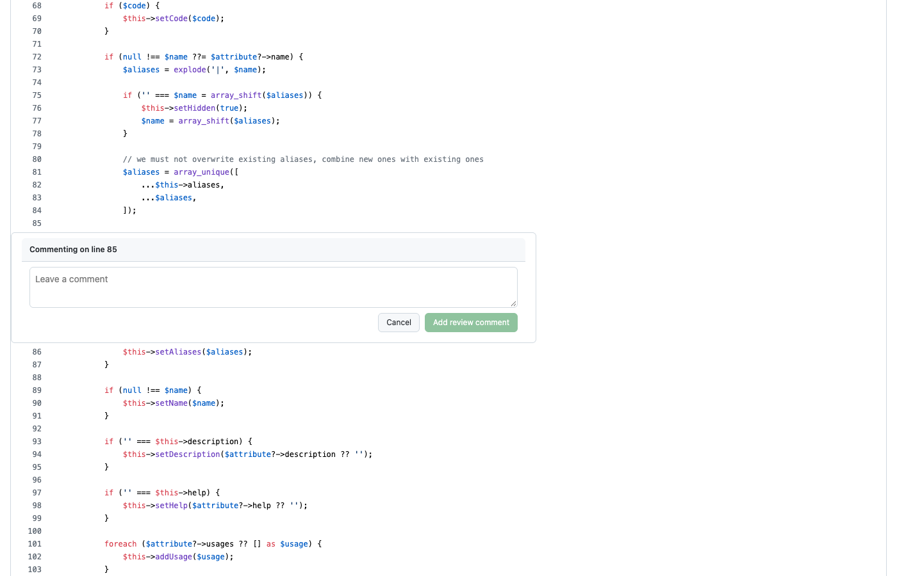 `@git-diff-view`: native range, then "+", gives "line 85" only | 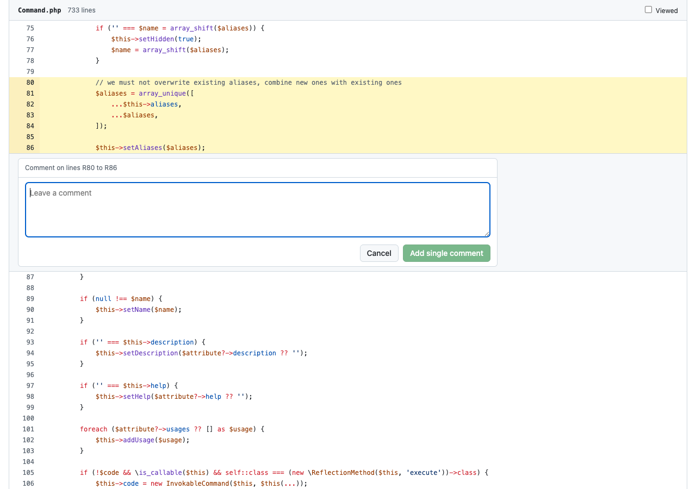 `react-diff-view`: drag range with 91 lines of glue |
| 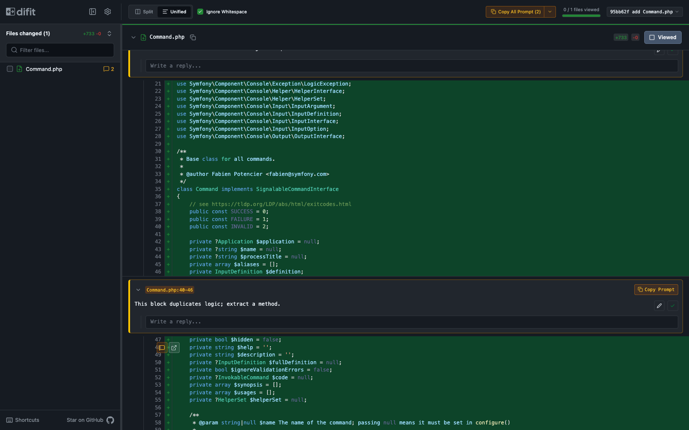 difit: empty-tree diff, every line added | 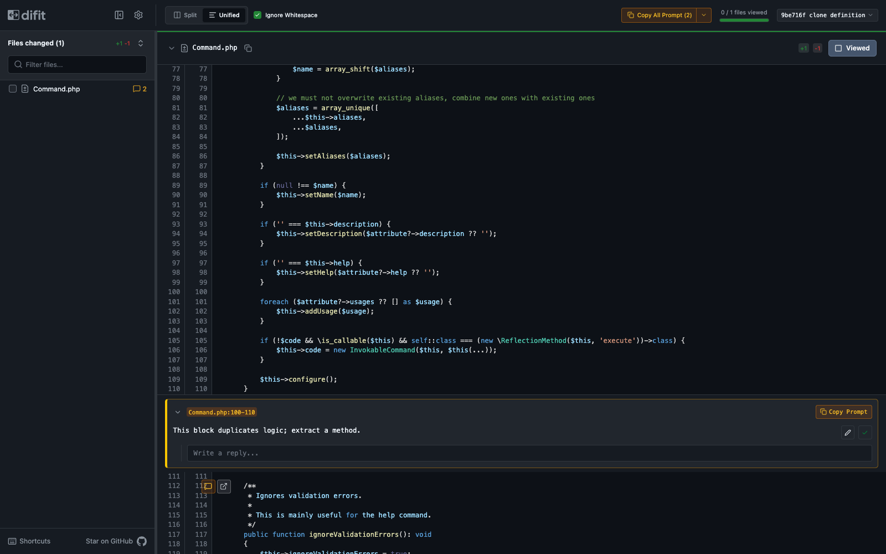 difit: full context, two number columns |

The spikes were joined into one end-to-end demonstration. A Symfony API, installed in its own directory, read the tree and the files of a clone of nikic/FastRoute from git at a pinned commit. The browser rendered them with the Primer tree and `@pierre/diffs`, including a comment box. Afterwards the clone was unchanged, and the API directory held no copy of the code.

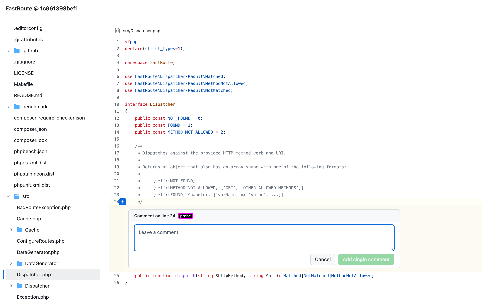

## 3. Domain model

### Value objects

| Type | Fields and types | Rules |
|---|---|---|
| `TenantId`, `UserId`, `RepositoryId`, `ReviewId`, `RequestId`, `CommentId`, `EventId`, `BatchId`, `DraftId`, `ApiTokenId` | `Symfony\Component\Uid\Ulid` | 26 characters, Crockford base32 |
| `CommitSha`, `BlobSha` | `string` | `^[0-9a-f]{40}$` or `^[0-9a-f]{64}$` for SHA-256 repositories |
| `RepositorySource` | enum: `github`, `local` | |
| `RepositoryName` | `string` | `owner/name` for `github`, as on GitHub. The directory name for `local`: no `/`, no leading `.`. Unique per tenant. |
| `RepoPath` | `string` | Relative, `/` separators, at most 4096 characters, no leading `/` or `-`, no empty, `.` or `..` segment, no NUL byte |
| `LineRange` | `startLine: int`, `endLine: int` | `1 <= startLine <= endLine` |
| `SymbolKind` | enum: `class`, `interface`, `trait`, `enum`, `function`, `method`, `property`, `class_constant`, `enum_case`, `constant` | |
| `SymbolRef` | `language: string`, `kind: SymbolKind`, `fqn: string` | `language` is `php` in the proof of concept. FQN example: `App\Billing\InvoiceTotals::total()` |
| `AnchorKind` | enum: `line`, `range`, `symbol`, `file` | |
| `ContentSnapshot` | `lines: list<string>`, `truncated: bool`, `lineCount: int`, `before: list<string>`, `after: list<string>`, `normalizedHash: string` | Section 5.1 |
| `Anchor` | `kind: AnchorKind`, `path: RepoPath`, `commitSha: CommitSha`, `blobSha: BlobSha`, `range: ?LineRange`, `symbol: ?SymbolRef`, `snapshot: ?ContentSnapshot` | `range` and `snapshot` are null only for `file`. `symbol` is set only for `symbol`. |
| `ActorKind` | enum: `user`, `agent`, `system` | `system` is the server itself, for example when a fetch finds a linked commit |
| `Actor` | `kind: ActorKind`, `userId: ?UserId`, `agentName: ?string` | An agent always acts for a user. `agentName` is the name of the API token. |
| `RequestStatus` | enum: `open`, `in_progress`, `ready_for_review`, `verified`, `reopened`, `wont_do` | Section 6 |
| `Awaiting` | enum: `agent`, `user`, `none` | Whose turn it is. Section 6. |
| `Resolution` | enum: `fixed`, `wont_do` | Set when a request closes |
| `ReviewState` | enum: `open`, `closed` | `closed` when `closedAt` is set |
| `SyncState` | enum: `cloning`, `failed`, `idle`, `fetching`, `unavailable` | State of the server clone. `unavailable` after access removal. |
| `CommitLinkState` | enum: `pending`, `available` | `pending` until the commit is in the server clone |
| `LocationStatus` | enum: `exact`, `shifted`, `changed`, `orphaned` | Section 5.3 |
| `OrphanReason` | enum: `file_deleted`, `region_deleted`, `ambiguous`, `content_not_found` | |
| `Location` | `targetSha: CommitSha`, `status: LocationStatus`, `path: ?RepoPath`, `range: ?LineRange`, `confidence: float`, `reason: ?OrphanReason` | Computed and cached, not an event |
| `ProposalState` | enum: `pending`, `approved`, `rejected` | Section 6 |
| `Proposal` | `eventId: EventId` (the `request.proposed` event), `state: ProposalState` | The current proposal of a claim |
| `ProposedDiff` | `string` | A unified diff in git format: 1 to 65,536 characters, 1 to 9 lines that start with `diff --git ` |

### Entities

Every entity except `Tenant` and `WebhookDelivery` carries `tenantId`.

| Entity | Fields and types |
|---|---|
| `Tenant` | `id`, `createdAt`, `eventSeq: int` (the last event number of the tenant), `deletionRequestedAt: ?DateTimeImmutable` (set by an account deletion) |
| `User` | `id`, `tenantId`, `signInMethod: github\|local`, `login: string`, `githubUserId: ?int`, `name: ?string`, `avatarUrl: ?string`, `createdAt`, `lastSignInAt` |
| `GitHubInstallation` | `id`, `tenantId`, `installationId: int`, `accountLogin: string`, `accountType: User\|Organization`, `suspendedAt: ?DateTimeImmutable` |
| `GitHubCandidate` | `id`, `tenantId`, `githubRepositoryId: int`, `installationId: int`, `accountLogin: string` (the account that the App is installed on), `owner: string`, `name: string`, `private: bool`, `defaultBranch: string`, `htmlUrl: string`, `listedAt`. A repository that the user can connect (R2): the sign-in replaces the rows, and the installation webhooks change them. |
| `Repository` | `id`, `tenantId`, `source: RepositorySource`, `name: RepositoryName`, `githubInstallationId: ?int`, `githubRepositoryId: ?int`, `githubPrivate: ?bool`, `localDirectory: ?string`, `defaultBranch: ?string`, `defaultBranchHead: ?CommitSha`, `syncState: SyncState`, `fetchRequested: bool` (a queued fetch job has not started), `lastFetchedAt: ?DateTimeImmutable`, `lastError: ?string`, `access: active\|removed`, `createdAt`. A `github` repository sets `githubInstallationId` and `githubRepositoryId`. The installation ID is a plain column, not a foreign key, so it survives the deletion of the `GitHubInstallation` row. A `local` repository sets `localDirectory`. |
| `Review` | `id`, `tenantId`, `repository: Repository`, `title: string`, `ref: string`, `commitSha: CommitSha`, `startedBy: Actor`, `indexState: pending\|running\|ready\|failed`, `createdAt`, `closedAt: ?DateTimeImmutable`, `closedBy: ?Actor`, `closeNote: ?string`, `state: ReviewState`, `lastEventSeq: int`, `filesTotal: ?int`, `filesDone: int`, `symbolsTotal: int`, `indexStartedAt: ?DateTimeImmutable`, `indexFinishedAt: ?DateTimeImmutable`, `indexError: ?string` |
| `ChangeRequest` | `id`, `tenantId`, `review: Review`, `anchor: ?Anchor`, null for a general request, `body: string` (Markdown), `author: Actor`, `createdAt`, `status: RequestStatus`, `statusBeforeClaim: ?RequestStatus`, `claimedBy: ?Actor`, `claimedAt: ?DateTimeImmutable`, `awaiting: Awaiting`, `resolution: ?Resolution`, `wontDoBy: ?ActorKind`, `lastUserCommentSeq: ?int`, `lastAgentEventSeq: ?int`, `lastAgentEventIsQuestion: bool`, `lastEventSeq: int`, `updatedAt`, `outdated: ?bool` (not event data: the location recompute sets it, and a projection rebuild keeps it), `carriedFrom: ?{reviewId: ReviewId, requestId: RequestId}` (the source request of a carried request, without a foreign key, so it survives the deletion of the source review), `requireApproval: bool` ("Ask for a plan first", fixed when the request opens), `proposal: ?Proposal` (stored as `proposalEventId` and `proposalState`) |
| `Comment` | `id`, `tenantId`, `request: ChangeRequest`, `author: Actor`, `body: string`, `question: bool`, `batchId: ?BatchId`, `createdAt` |
| `CommitLink` | `tenantId`, `request: ChangeRequest`, `commitSha: CommitSha`, `state: CommitLinkState`, `linkedBy: Actor`, `linkedAt`, `foundAt: ?DateTimeImmutable`, `subject: ?string`, `committedAt: ?DateTimeImmutable`, `note: ?string`. `subject` and `committedAt` are set when `state` is `available`. Unique per request and commit. |
| `Draft` | `id`, `tenantId`, `review: Review`, `user: User`, `kind: new_request\|reply`, `anchor: ?Anchor`, `request: ?ChangeRequest`, `body: string`, `requireApproval: bool` (always false for a reply), `createdAt`, `updatedAt` |
| `ViewedFile` | `id`, `tenantId`, `review: Review`, `user: User`, `path: RepoPath`, `pathHash: string` (SHA-256 of the path, in the unique key) |
| `ApiToken` | `id`, `tenantId`, `user: User`, `name: string` (the agent name), `repository: ?Repository` (null means all repositories of the tenant), `tokenHash: string` (SHA-256), `prefix: string` (for display), `createdAt`, `expiresAt: ?DateTimeImmutable`, `lastUsedAt: ?DateTimeImmutable`, `revokedAt: ?DateTimeImmutable` |

`ChangeRequest`, `Comment`, `CommitLink`, and the event columns of `Review` are projections of the event log. `User` and `Tenant` are separate so that a tenant can get more users later. Each request, comment, draft, viewed-file mark, and `get_updates` cursor belongs to exactly one review.

### Events

Table `review_event`, append-only:

| Field | Type | Notes |
|---|---|---|
| `id` | `EventId` | |
| `tenantId` | `TenantId` | |
| `seq` | `int` | Gapless per tenant and in commit order. Section 4. |
| `reviewId` | `ReviewId` | |
| `requestId` | `?RequestId` | Null for review, batch, and commit events |
| `requestIds` | `jsonb` | Every request that the event concerns: `[requestId]` for request events and `commit.unlinked`, the payload `requestIds` for `commit.linked`, `commit.found`, and `batch.submitted`, `[]` for review events |
| `type` | `string` | Table below |
| `actor` | `Actor` | |
| `occurredAt` | `timestamptz` | |
| `payload` | `jsonb` | Per type |

| Type | Payload |
|---|---|
| `review.started` | `title`, `ref`, `commitSha` |
| `review.closed` | `note: ?string` |
| `request.opened` | `anchor: ?Anchor`, null for a general request, `body`, `batchId: ?BatchId`, `carriedFrom: ?{reviewId, requestId}`, set only for a request that V15 carried over from another review, `requireApproval: bool`, read as false when missing |
| `request.commented` | `commentId`, `body`, `question: bool`, `batchId: ?BatchId` |
| `request.claimed` | none |
| `request.released` | `note: ?string` |
| `commit.linked` | `commitSha`, `requestIds: list<RequestId>`, `note: ?string`, `available: bool`, `subject: ?string`, `committedAt: ?DateTimeImmutable`. `subject` and `committedAt` are set when `available` is true. |
| `commit.unlinked` | `commitSha`, `requestId` |
| `commit.found` | `commitSha`, `requestIds: list<RequestId>`, `subject: string`, `committedAt: DateTimeImmutable`. Actor `system`. One event per review. |
| `request.ready_for_review` | `note` |
| `request.wont_do` | `reason`, at least 20 characters |
| `request.verified` | `note: ?string` |
| `request.reopened` | `note` |
| `request.proposed` | `plan` (Markdown), `diff: ?ProposedDiff` |
| `request.proposal_approved` | `proposalEventId: EventId`, `note: ?string`. Actor `user`. |
| `request.proposal_rejected` | `proposalEventId: EventId`, `note`. Actor `user`. |
| `batch.submitted` | `batchId`, `summary: ?string`, `requestIds` (the opened and the commented requests), `commentIds` |

Stored events are never rewritten. New payload fields are additive, and readers use a default for a missing field. Each type has an explicit codec. The API `Event` is a derived representation, not the stored payload. The `commit.*` payloads carry the git data of `CommitLink`, so a rebuild from the log needs no clone.

Example `request.opened` payload:

```json
{
  "batchId": "01K6B3P1Z8Y7X6W5V4T3S2R1Q0",
  "body": "Use `Money` instead of `float` for totals.",
  "anchor": {
    "kind": "symbol",
    "path": "src/Billing/InvoiceTotals.php",
    "commitSha": "79f8595a4c1e2b3d5f6071829a3b4c5d6e7f8091",
    "blobSha": "3b18e512dba79e4c8300dd08aeb37f8e728b8dad",
    "range": {"startLine": 38, "endLine": 49},
    "symbol": {"language": "php", "kind": "method", "fqn": "App\\Billing\\InvoiceTotals::total()"},
    "snapshot": {
      "lines": ["    /**", "     * Sum of all invoice lines.", "     */", "    public function total(): float", "    {", "        $sum = 0.0;", "        foreach ($this->lines as $line) {", "            $sum += $line->amount;", "        }", "", "        return $sum;", "    }"],
      "truncated": false, "lineCount": 12, "before": ["    }", "", ""], "after": ["", "    public function tax(): float", "    {"],
      "normalizedHash": "sha256:4cd0f94b186ef4903963fa0397ae6175cd9f82d31d4512d8e9b67a2b3a0142f9"
    }
  },
  "carriedFrom": null,
  "requireApproval": false
}
```

## 4. Storage

### PostgreSQL

PostgreSQL 18 is the source of truth, through Doctrine ORM, with schema changes through Doctrine Migrations. The application uses one database role. The event store only inserts into `review_event`. Only the deletion use cases delete events. Projections change in the same transaction as their events. A console command rebuilds all projections from the log.

Write transaction:

```text
BEGIN
  SELECT event_seq FROM tenant WHERE id = :tenantId FOR UPDATE    -- one writer per tenant at a time
  load the projections of the affected requests
  events = command.decide(state)                                  -- throws a DomainError
  number the events from event_seq + 1, UPDATE tenant SET event_seq
  INSERT INTO review_event ..., UPDATE the projections
COMMIT
publish one live update for the transaction
```

`:tenantId` comes from the tenant context of the application, never from input. The per-tenant counter under a row lock gives numbers without gaps, in commit order. So `get_updates(review, cursor)` never misses an event that commits late, which a global database sequence cannot promise. With one user per tenant, the lock has almost no contention.

### Tenant isolation

| Layer | Measure |
|---|---|
| Tenant context | Set from the signed-in user, the API token, the tenant stamp of a Messenger message, or the tenant ID that an operator gives to a console command. It fails closed: without a tenant context, a query on a tenant table fails. |
| Application | A Doctrine SQL filter adds `tenant_id = :tenant` to every ORM query. It is on by default. Only `TenantFilter::suspend()` turns it off, in four places: the sign-in and token lookup, the webhook router, the projection rebuild, and the purge. |
| Raw SQL | The SQL filter does not cover DBAL queries or identity-map hits. Every raw SQL statement on a tenant table names its tenant column: `tenant_id`, or `id` on the `tenant` table. An audit test checks this. The entity manager is cleared between worker requests and between Messenger messages. |
| Files | Clones in `<data>/tenants/<tenantId>/repositories/<repositoryId>.git`. Paths come from IDs, never from input. Two tenants who connect the same repository get two clones. |
| Live updates | Mercure topics contain the tenant ID. The subscriber token allows only the tenant's own topics. |
| Scoped tokens | A token scoped to one repository sees only that repository and its reviews. Everything else answers `not_found`. |
| GitHub | Each installation token is limited to one repository and `contents: read` |
| Tests | A cross-tenant suite calls every route and MCP tool with another tenant's IDs and expects 404. See section 10. |

Row-level security and separate database roles are a backlog item: [database-hardening.md](backlog/database-hardening.md).

### Repository sources and the server clone

| | GitHub source | Local source |
|---|---|---|
| Enabled | The GitHub App is configured | `APP_LOCAL_REPOSITORIES_DIR` is set. Off when the variable is empty. An instance feature: every tenant of the instance may connect these repositories. |
| Candidates | Installation repositories, listed at each sign-in | Direct child directories of `APP_LOCAL_REPOSITORIES_DIR` that contain `.git` or are bare repositories. Names that start with `.` are skipped. |
| Fetch source | `https://github.com/<owner>/<name>.git` | `file://` and the realpath of the directory |
| Credentials | A fresh installation token as a per-command `http.https://github.com/.extraheader` with `AUTHORIZATION: basic`, the method of `actions/checkout`. It reaches git only through the `GIT_CONFIG_COUNT`, `GIT_CONFIG_KEY_<n>`, and `GIT_CONFIG_VALUE_<n>` environment variables, never through argv or `.git/config`, because `symfony/process` exceptions print the argv. | None. The `git upload-pack` command that reads the source runs with `-c safe.directory=<realpath>` and `-c safe.directory=<realpath>/.git`, through `--upload-pack`, because git drops the `-c` options of the fetching git on a local transport. |
| Path check | Not applicable | The parent of `realpath(<directory>)` must equal `realpath(APP_LOCAL_REPOSITORIES_DIR)`, so symlinks cannot escape the mount |
| Commit becomes available | After a push and a fetch | After a commit on a branch of the connected repository and a fetch |
| Writes to the source | Never | Never. Docker mounts the directory read-only. |

Server clone rules:

- One bare clone per repository at `<data>/tenants/<tenantId>/repositories/<repositoryId>.git`.
- The fetch refspecs are `+refs/heads/*:refs/heads/*` and `+refs/tags/*:refs/tags/*`, with `--prune`. Never `--mirror`.
- A second `git fetch` gets the pending linked SHAs by ID into `refs/holistic-review/commits/<sha>`. One unknown SHA fails a whole `git fetch`, so after a failure the server fetches one SHA per command and ignores the failures.
- A commit is available when `git cat-file -e <sha>^{commit}` succeeds in the clone.
- **Pin refs.** At review start the server writes `refs/holistic-review/reviews/<reviewId>` to the review commit. When a linked commit is available, it writes `refs/holistic-review/commits/<sha>`. The fetch refspecs never touch `refs/holistic-review/*`, so force-pushes, `--prune`, and `git gc` cannot remove reviewed or linked commits. Deleting a review deletes its review pin. A commit pin is deleted when no remaining link in the repository uses the SHA.

Fetch triggers:

| Trigger | GitHub source | Local source | Mode |
|---|---|---|---|
| Connect | clone | clone | async job |
| `push` webhook | fetch | none, because no webhooks exist | async job |
| "Refresh" in the UI (`POST /api/v1/repositories/{id}/fetch`) | fetch, or clone again after a failed clone | same | async job |
| Review start, unless `ref` is a full SHA already in the clone | fetch | fetch | sync, 60 s |
| `link_commits` with a pending link | fetch, as a fallback to the webhook | fetch | async job, debounced 5 s per repository |
| `mark_ready_for_review` with pending links | fetch | fetch | sync, 60 s |
| `get_request` with an `at` commit that is not in the clone | fetch | fetch | sync, 60 s |

- **Single flight.** A `symfony/lock` key `fetch:<repositoryId>` lets one fetch run at a time. The lock store uses PostgreSQL advisory locks, because the `php` and `worker` containers share the clones. A request that arrives during a fetch sets a flag, and one more fetch runs afterwards.
- **After every successful fetch:** set `lastFetchedAt`, clear `lastError`, read the default branch and its head, and resolve pending links. A resolved link becomes `available`, gets its pin, and causes one `commit.found` event per review. When the default-branch head changed, the default-branch locations of the open reviews are computed again. Then the live updates are published. The steps are in [webhooks-and-live-updates.md](specs/webhooks-and-live-updates.md).
- **Failure.** `lastError` is set. A synchronous trigger answers `repository_unavailable` with reason `fetch_failed`.

### Reading code and the index

- **Reading code.** No import step. The server reads the pinned commit from its clone: `git ls-tree` for directories, one `git cat-file --batch` process for content, the blob SHA as `ETag`. The phase 1 demonstration proved this chain with a clone of nikic/FastRoute. See section 2.
- **Index.** A Messenger job at review start writes the path list of the commit into `indexed_file`, with the columns `tenantId`, `repositoryId`, `commitSha`, `pathSha256`, `path`, `blobSha`, `mode`, and `sizeBytes`. It writes the PHP symbols of each blob into `symbol`, with the columns `id`, `tenantId`, `repositoryId`, `blobSha`, `kind`, `fqn`, `fqnSha256`, `name`, `parentFqn`, `startLine`, `endLine`, `declarationStartLine`, and `docStartLine`. `indexed_blob` marks each parsed blob, with `parseError`, so blobs without symbols are also skipped. The index belongs to a commit of a repository, not to a review, because it is code data. Reviews of the same commit share it. `nikic/php-parser` needs 22 ms for a 3,534-line file. The UI shows the progress.
- **Code navigation.** V14 parses one file on demand, resolves the clicked or typed name with php-parser's `NameResolver`, and looks up its declarations in `symbol` by the SHA-256 of the FQN, then by the FQN, joined with the `indexed_file` rows of the review commit. The index holds the hash, because a btree entry of a long multibyte FQN exceeds the PostgreSQL limit. There is no reference index (D46).
- **Quick open.** V16 finds the paths of `indexed_file` and the symbol names of `symbol` of the review commit that contain a text, case-insensitively, and ranks them in SQL. It uses the existing indexes and no name index: on this repository, 1,337 files and 4,792 symbols, the query takes 2 to 7 ms (D48).
- **Limits.** Files above 1 MiB (1,048,576 bytes) and binary files show no code but take file comments. The proof of concept has no limit on repository size or counts. See [usage-limits.md](backlog/usage-limits.md).

### Sign-in and sessions

- **GitHub sign-in.** The `oauth` authenticator of HWIOAuthBundle with its `github` resource owner and `csrf: true`. A custom `OAuthAwareUserProviderInterface` service creates the tenant and the user at the first sign-in.
- **Local sign-in.** `APP_LOCAL_SIGN_IN=<login>` signs the browser in as one local user and tenant, without OAuth. The `/login` page then shows a "Sign in as <login>" button that posts to `POST /login/local`. It works only when `APP_ENV=dev`: the route exists only in `dev`, and the authenticator supports no request in any other environment. It logs a warning when the variable is set outside `dev`. The first sign-in creates the tenant and the local user.
- **E2E sign-in.** The route `/_e2e/sign-in/{login}` exists only in the `e2e` environment, for the full-stack E2E tests.
- **Sessions.** A Symfony session, stored in PostgreSQL with `PdoSessionHandler`. The session holds the security token with a serialized copy of the user, and the OAuth `state`. It never holds review data.
- **Firewalls.** `api_bearer` is stateless and uses the `access_token` authenticator. A request matcher selects it for `^/api/v1` with an `Authorization: Bearer` header, so the bearer token wins over a session cookie, and a bearer request never touches the session. `api` covers the other `^/api/v1` requests and shares the security context of `main`. `main` uses the session. `mcp` covers `^/_mcp`, is stateless, and uses the same token handler. The token handler looks up the SHA-256 hex digest of the token.

### Deletion

When a repository leaves the installation, or the installation is deleted, the server marks the repository `removed` and queues a Messenger job that deletes the clone and the index. Reviews stay until the user deletes them, because they are the user's work. See D22. The user can delete one review, one repository's data, or the whole account. A review deletion and a repository deletion delete their rows in the request, under the tenant row lock of the write transaction. A Messenger job then deletes the clone of a deleted repository. An account deletion marks the tenant, and a job deletes all rows and files of the tenant. The jobs run as the normal database role, with the tenant context of the tenant whose data they delete. The purge command deletes all rows and files of one tenant.

## 5. Anchoring and re-anchoring

### 5.1 Capture

All anchors are captured at the review commit, which never changes. A general request has no anchor, so it is never captured and never located: its `location` and `outdated` stay null.

| Kind | Stored data |
|---|---|
| `file` | `path`, `commitSha`, `blobSha` |
| `line`, `range` | As `file`, plus `range` and `snapshot` |
| `symbol` | As `range`, plus `symbol`. The range comes from `nikic/php-parser` and includes the doc comment (D7). |

Snapshot rules: normalize each line to LF line endings with no trailing whitespace. `lines` holds up to 200 lines, else the first 100 and the last 100 with `truncated: true`. `before` and `after` hold up to 3 context lines each.

All content comparisons use the comparison form of a line: leading and trailing whitespace removed, each inner whitespace run replaced by one space. So a re-indented region still matches. `normalizedHash` is `sha256:` and the SHA-256 hex of the comparison form of the full region, lines joined with LF, no final LF. A match for a truncated snapshot is a window of `lineCount` lines with the same hash.

### 5.2 Targets

The server sees only commits in its clone. It cannot see the developer's working tree. A commit reaches the clone after a push for a GitHub source, or after a commit on a branch of the connected repository for a local source. Both cases need a fetch, see section 4.

| Target | Used by | Cache |
|---|---|---|
| Default branch head at the last fetch | "Outdated" label and filter | Key: event ID and target SHA |
| A linked commit | "Changes" tab of the request | Key: event ID and target SHA |
| A commit that the agent names | `get_request` with `at` | Key: event ID and target SHA |

For changes that are not in the server clone, the agent finds the code itself from the snapshot, the context lines, and the symbol FQN. The skill tells it how.

### 5.3 Location statuses

| Status | Meaning |
|---|---|
| `exact` | Same path, same lines, same normalized content |
| `shifted` | Same normalized content at other lines or another path |
| `changed` | Region found, content differs. `confidence` is 1 for a file anchor and for a symbol found by its FQN, else the line similarity of section 5.4. |
| `orphaned` | Region not found. `reason` says why. |

A request is `outdated` when its location at the default-branch head is `changed` or `orphaned`. This is the meaning of "outdated" on GitHub.

### 5.4 Algorithm

```text
locate(anchor, targetSha):
  path = mapPath(anchor.commitSha, targetSha, anchor.path)          # git diff --name-status -M
  if path is null:
    return searchOtherFiles(anchor, targetSha) or orphaned(file_deleted)
  if blobSha(targetSha, path) == anchor.blobSha:
    return (path == anchor.path) ? exact(anchor.range) : shifted(path, anchor.range)
  if anchor.kind == file:
    return changed(path, range: null, confidence: 1.0)
  if the file at path is not renderable:
    return orphaned(content_not_found)
  if anchor.kind == symbol:
    symbol = symbolIndex(targetSha, path).find(anchor.symbol.fqn)    # parse error gives no table
    if symbol found:
      same = hash(symbol.range) == anchor.snapshot.normalizedHash
      return same ? shifted-or-exact(path, symbol.range) : changed(path, symbol.range, 1.0)
  hunks  = git diff --unified=0 --text <anchor.blobSha> <blobSha(targetSha, path)>
  mapped = mapRange(anchor.range, hunks)
  if mapped.untouched:
    return shifted-or-exact(path, mapped.range)
  if snapshot is distinctive:                                        # at least 8 non-whitespace characters
    matches = exactNormalizedMatches(targetSha, path, anchor.snapshot)
    if matches not empty:
      best = nearest(matches, mapped.start)
      return tie ? orphaned(ambiguous) : shifted-or-exact(path, best)
  if mapped.keepsSomeLines:
    return changed(path, mapped.range, similarity(mapped.range, anchor.snapshot))
  if snapshot is distinctive:                                        # F10: no content search for a trivial snapshot
    fuzzy = bestWindow(targetSha, path, anchor.snapshot, near: mapped.start)
    if fuzzy.score >= 0.6:
      return changed(path, fuzzy.range, fuzzy.score)
  return searchOtherFiles(anchor, targetSha) or orphaned(region_deleted)

searchOtherFiles(anchor, targetSha):
  only for a distinctive snapshot of 3 or more lines
  git grep --files-with-matches -I -F -e <longest snapshot line, trimmed, first 1,000 bytes> <targetSha>   # at most 20 candidate files
  verify each candidate with exactNormalizedMatches
```

`mapRange` maps each boundary line through the `--unified=0` hunks. A line outside every hunk moves by the sum of the deltas of the hunks above it. A line inside a hunk maps to the new side of that hunk.

`similarity(a, b)` is `2 * m / (|a| + |b|)`, where `m` is the length of the longest common subsequence of the two line lists in comparison form (section 5.1).

### 5.5 Failure cases

| # | Case | Result |
|---|---|---|
| F1 | File deleted, no rename | `orphaned`, `file_deleted`, unless another file has the snapshot |
| F2 | File renamed, 50% or more similar | Path mapped, then normal steps |
| F3 | File renamed and much changed | Delete and add for git. `searchOtherFiles` may find it. Else `orphaned`. |
| F4 | Lines added or removed above the region | `shifted` |
| F5 | Region edited, for example by the agent's fix | `changed`, with the mapped range and a similarity |
| F6 | Region moved inside the file | `shifted` |
| F7 | Region moved to another file | `shifted` through `git grep`, else `orphaned` |
| F8 | Region deleted | `orphaned`, `region_deleted` |
| F9 | Duplicate code, equal distance | `orphaned`, `ambiguous`. We do not guess. |
| F10 | Trivial snapshot, such as `}` | No content search, diff mapping only |
| F11 | Whitespace or line-ending change | `exact` or `shifted`, because the comparison is normalized |
| F12 | PHP syntax error at the target | No symbol table. Line steps run instead. |
| F13 | Symbol renamed | FQN not found. Line steps give `changed` or `orphaned`. |
| F14 | Target commit not in the server clone | One fetch, then error `commit_not_found` |

A request is never dropped. An orphaned request keeps its original anchor. The review view always shows the code at the review commit, so the thread stays at its original position there, with an "Outdated" label.

## 6. Lifecycle

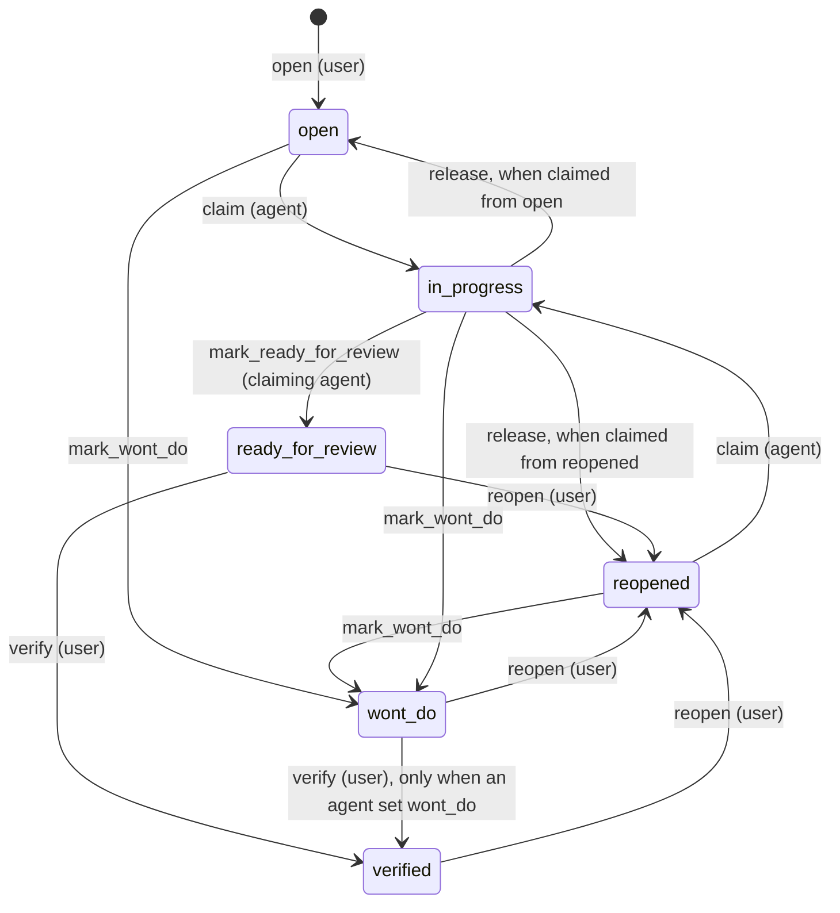

| Command | From | To | Actor | Input | Checks |
|---|---|---|---|---|---|
| `open` | none | `open` | User | Anchor, body | Anchor valid at the review commit |
| `claim` | `open`, `reopened` | `in_progress` | Agent | None | A second claim by the same agent succeeds and changes nothing |
| `release` | `in_progress` | Status before the claim | Claiming agent, or user ("Unassign") | Optional note | |
| `link_commits` | `in_progress` | Unchanged | Claiming agent | Full commit SHA, 1 to 50 request IDs of one review, optional note | Every named request is claimed by the caller, and its proposal gate is open. One commit may cover several requests. The commit may still be missing from the server clone: its link is `pending`. Pairs that are already linked are skipped. |
| `unlink_commit` | `in_progress` | Unchanged | Claiming agent | Full commit SHA, request ID | |
| `mark_ready_for_review` | `in_progress` | `ready_for_review` | Claiming agent | Note | The proposal gate is open. Every linked commit must be `available`. The server fetches once. A `pending` link gives `commits_not_available`. Zero links are allowed, for a request that needs no code change. |
| `mark_wont_do` | `open`, `reopened`, `in_progress` | `wont_do` | Agent (the claiming agent when `in_progress`), or user | Justification of 20 or more characters | The agent must give evidence |
| `verify` | `ready_for_review`, or `wont_do` set by an agent | `verified` | User | Optional note | |
| `reopen` | `ready_for_review`, `wont_do`, `verified` | `reopened` | User | Note | |
| `reply` | Any | Unchanged | User or agent | Body; `question` flag for agents | |
| `propose_solution` | `in_progress` | Unchanged | Claiming agent | Plan, optional unified diff | The diff is in git format, 1 to 9 files. A new proposal replaces the current one. |
| `approve_proposal` | `in_progress` | Unchanged | User | ID of the proposal, optional note | The proposal is pending, and the ID names it |
| `reject_proposal` | `in_progress` | Unchanged | User | ID of the proposal, note | As `approve_proposal` |

A linked commit never changes the status. Only `mark_ready_for_review` says that the agent is finished. Two actors are the same when kind, `userId`, and `agentName` match, so a rotated token with the same name acts as the same agent.

A proposal is a sub-state of `in_progress`, like a question: `proposal` is `{eventId, state}` with `ProposalState` `pending`, `approved`, or `rejected`, or null. Release, won't do, and reopen set it to null, because a proposal belongs to one claim. The proposal gate is open when `proposal` is null or approved, and approved when `requireApproval` is true. `requireApproval` is set when the request opens and does not change.

`awaiting` is derived after each event. The first matching rule wins:

| # | Rule | `awaiting` |
|---|---|---|
| 1 | `verified`, or `wont_do` set by the user | `none` |
| 2 | The last user message or proposal decision is newer than the last agent event | `agent` |
| 3 | The last agent event is a reply with `question: true`, or a proposal is pending | `user` |
| 4 | `open`, `reopened`, `in_progress` | `agent` |
| 5 | `ready_for_review`, or `wont_do` set by an agent | `user` |

Derived fields: `closed` is true for `verified` and for `wont_do` set by the user. `resolution` is `fixed` after `ready_for_review` and `wont_do` after a `wont_do`. `verify` keeps it, and `reopen` sets it to null.

### Review lifecycle

| Command | From | To | Actor | Input | Effect |
|---|---|---|---|---|---|
| `start` | none | `open` | User | Optional `ref` (default: the default branch), optional `title` | Resolves the ref to a SHA in the server clone, writes the review pin, writes `review.started`, queues the index job |
| `close` | `open` | `closed` | User | Optional note | Writes `review.closed`, sets `closedAt`, `closedBy`, and `closeNote`, deletes the user's drafts of the review |

A closed review is read-only. Every write on it or on its requests fails with `review_closed`: commands, comments, new requests, draft creation, draft updates, draft submission, and viewed files. A carry-over (V15) into a closed review answers 422 `invalid_input` instead (D47). Reads, draft deletion, and review deletion (V13) still work. Claims stay as they are. `allowedActions` is empty. Lists hide closed reviews unless the caller asks for them. Reopening a closed review is a backlog item: [review-reopen.md](backlog/review-reopen.md).

| Ours | GitHub concept |
|---|---|
| `open` | Unresolved conversation |
| `in_progress` | No equivalent. Nearest: an assignee. |
| `ready_for_review` | "Re-request review". Copilot reason ADDRESSED. |
| `wont_do` | Resolved with a reply. Copilot reason WONT_FIX. |
| `verified` | "Resolve conversation" |
| `reopened` | "Unresolve conversation" |
| `commit.linked` | A commit in the PR timeline |
| `outdated`: location `changed` or `orphaned` at the default branch | Outdated |
| Draft, batch | Pending review, submitted review |
| Closed review | Closed pull request |

## 7. Interfaces

### 7.1 One application layer

```text
Web UI and REST API      MCP over HTTP      Webhook consumer      Messenger handlers
            \                  |                  |                     /
             Application services: commands and queries, the locator, one Serializer normalizer set
                                        |
             Domain: value objects, events, reducer, state machine, anchor matching
                                        |
             Ports: Doctrine repositories, the `github.client` HTTP client, BareClone, GitReader, PhpSymbolExtractor, LivePublisher
```

- Adapters map input and normalize the result. Logic that several adapters share is in an application service. Logic with one caller stays in its adapter. A `kernel.request` listener and a Messenger middleware set the tenant context. MCP and REST return the same JSON.
- Actor: the web UI acts as `user`. An API token acts as `agent` for its user, and `agentName` is the token name, for example "claude-code laptop".
- Request commands respond with a `RequestCommandResult`: the request summary, the caller's `allowedActions`, and the events that the command wrote. `open` responds with the `Request`, and `link_commits` with a `LinkCommitsResult`. The other commands do not return the full request, so the agent's context stays small.

### 7.2 Contracts

[docs/specs/](specs/README.md) is the source of truth for every contract. When this section and the specifications differ, the specifications win.

- [README.md](specs/README.md): conventions, authentication, errors with their check order and `details` shapes, pagination, caching, repository sources, versioning, and the index of schemas and fixtures.
- [rest-api.md](specs/rest-api.md) and [rest-api-requests.md](specs/rest-api-requests.md): every REST endpoint with its method, path, authentication mode, input, output, errors, and an example.
- [mcp.md](specs/mcp.md): the MCP endpoint, the server `instructions`, and every tool with its input schema, output schema, annotations, and errors.
- [webhooks-and-live-updates.md](specs/webhooks-and-live-updates.md): GitHub webhooks, fetch triggers, and Mercure topics and payloads.
- [schemas/](specs/schemas/): the JSON Schemas, draft 2020-12, with the `$id` base `https://holistic-review.invalid/schemas/v1/`. Tests validate every REST response and every MCP `structuredContent` against them with `opis/json-schema`. The front-end TypeScript types are written from them.

Error codes for all adapters. The body is `{"error": {"code", "message", "details"}}`. The checks run in a fixed order, and `details` has a fixed shape per code.

| Code | HTTP | Meaning |
|---|---|---|
| `unauthorized` | 401 | No credential, or the credential is wrong, revoked, or expired |
| `forbidden` | 403 | This actor kind may not call this endpoint, or the CSRF check failed |
| `not_found` | 404 | Unknown route, ID, or name. Also another tenant's ID and a repository outside the token's scope. |
| `invalid_input` | 400, 405, 413, 415, 422 | Malformed input, wrong method, body too large, not JSON, or a failed validation |
| `invalid_transition` | 409 | The request's status or claim holder does not allow the command |
| `review_closed` | 409 | A write on a closed review or on one of its requests |
| `commits_not_available` | 409 | A linked commit is still `pending` after one fetch |
| `commit_not_found` | 422 | A ref or commit that the caller named is not in the server clone after one fetch |
| `repository_unavailable` | 409 | The repository is cloning, its clone or fetch failed, or its access was removed |
| `internal_error` | 500 | An unexpected failure. It is logged. The message is generic. |

### 7.3 MCP server

- **Endpoint:** `https://<host>/_mcp`, Streamable HTTP, through the `symfony/mcp-bundle` HTTP transport, which needs `nyholm/psr7`. Server name `holistic-review`. The phase 1 spike verified the handshake and the 2026-07-28 `server/discover` over HTTP. `http.allowed_hosts` defaults to localhost, so it must list the public host.
- **Sessions:** clients of the handshake era, up to 2025-11-25, need MCP sessions. They use the bundle's `file` session store under `var/mcp-sessions`, because there is one `php` container. A shared store is a backlog item: [mcp-session-store.md](backlog/mcp-session-store.md).
- **Authentication:** the stateless `mcp` firewall with Symfony's `access_token` authenticator. A wrong token gets HTTP 401 before JSON-RPC. The bundle docs say that resource-server authentication is "plain Symfony Security". MCP OAuth is a backlog item: [mcp-oauth.md](backlog/mcp-oauth.md). See D18.
- **Configuration** in the developer's repository:

```json
{"mcpServers": {"holistic-review": {"type": "http", "url": "https://<host>/_mcp", "headers": {"Authorization": "Bearer ${HOLISTIC_REVIEW_TOKEN}"}}}}
```

| Tool | Input | Annotations |
|---|---|---|
| `list_repositories` | `cursor?`, `limit?` | readOnly, idempotent |
| `list_reviews` | `repository` (ID, GitHub `owner/name`, or local directory name), `includeClosed?`, `cursor?`, `limit?` | readOnly, idempotent |
| `list_requests` | `review`, `status?`, `awaiting?`, `path?`, `outdated?`, `cursor?`, `limit?` | readOnly, idempotent |
| `get_updates` | `review`, `cursor?`, `limit?` | readOnly, idempotent |
| `get_request` | `id`, `at?` (commit SHA, 7 to 64 hex digits), `context?` | readOnly, idempotent |
| `claim_request` | `id` | idempotent |
| `release_request` | `id`, `note?` | |
| `reply_to_request` | `id`, `body`, `question?` | |
| `link_commits` | `commitSha` (full SHA), `requestIds` (1 to 50, one review), `note?` | idempotent |
| `unlink_commit` | `commitSha` (full SHA), `requestId` | |
| `mark_ready_for_review` | `id`, `note` | |
| `mark_wont_do` | `id`, `reason` with `minLength: 20` | |
| `propose_solution` | `id`, `plan`, `diff?` (unified diff, at most 9 files) | |

All tools set `destructiveHint: false` and `openWorldHint: false`. Parameters are scalars, backed enums, and arrays of scalars, because the SDK does not support object parameters. Array parameters declare `items` through `#[Schema]`. A domain error becomes a `ToolCallException` with the Error JSON as text, so the result has `isError: true` and no `structuredContent`. Every other exception becomes `internal_error`. Input-schema violations give JSON-RPC error -32602 before the tool runs. `unauthorized` arrives as HTTP 401 on the transport, and `forbidden` never occurs in MCP.

The agent polls `get_updates` with the last cursor, for example through Claude Code's `/loop`. The server never pushes to the agent.

### 7.4 REST API

The web UI and agents without MCP use the same services under `/api/v1`. The UI authenticates with its session and the stateless CSRF token ID `api`. Agents authenticate with the bearer token. The JSON is the same as in MCP.

The endpoint groups are account, repositories, reviews and code, requests, drafts, and tokens. The index with every method, path, authentication mode, and schema is in [rest-api.md](specs/rest-api.md). V15 carries the open requests of a review over to another review of the same repository, re-anchored at its commit. It has no MCP tool, because agents never open requests. Routes outside `/api/v1`: the Twig shell pages of the React application, the sign-in routes, `/docs` and `/docs/<slug>`, `/docs/skill/SKILL.md`, `/docs/schemas/v1/<name>.schema.json`, `/github/installed`, `/healthz`, `/_mcp`, `POST /webhook/github`, and the Mercure hub at `/.well-known/mercure`.

### 7.5 Webhooks and live updates

- **Webhooks:** `POST /webhook/github`, from the route prefix `/webhook` of the `symfony/webhook` recipe. The parser checks the HMAC of the raw body with `hash_equals()` before it decodes JSON. Every verified delivery returns a `RemoteEvent`, because a `null` result gives 406. A `webhook_delivery` table drops duplicate deliveries. Events that queue jobs: `push`, `installation`, `installation_repositories`, and `repository`. `github_app_authorization` with action `revoked` is logged, and `ping` changes nothing. The consumer runs with the tenant filter suspended, and each resulting job carries its `tenantId`.
- **Live updates:** private Mercure updates, published after the transaction commits, one update per transaction. Topics: `{base}/tenants/{tenantId}/repositories` and `{base}/tenants/{tenantId}/reviews/{reviewId}`. The subscriber cookie comes from `POST /api/v1/mercure/authorize`. Agents do not subscribe.
- **Payloads carry IDs only.** The review topic carries `events` as `{type, reviewId, seq, requestIds}`, `outdated` as `{type, reviewId, requestIds}`, and `index` as `{type, reviewId}`. The repositories topic carries `repository` and `repository_deleted` as `{type, repositoryId}`, and `candidates_changed` as `{type}`. The browser revalidates its React Router loaders when an update arrives, and reads the data again through REST. After a reconnect, it catches up with `GET /api/v1/reviews/{id}/updates?cursor=`. A failed publish is logged and not retried, because the write already committed.

### 7.6 Console

Operator commands: rebuild projections, rebuild an index, purge a tenant. `app:schema:bundle` generates `src/Mcp/BundledSchemas.php` for developers. Agents use MCP or the REST API. See D20.

### 7.7 Agent Skill and public documentation

- The skill source is [docs/user/skill/SKILL.md](user/skill/SKILL.md). The application serves it raw at `GET /docs/skill/SKILL.md`. The developer installs it into `.claude/skills/holistic-review/SKILL.md` of the reviewed repository with one `curl` command. See D9 and D28.
- The skill teaches the agent to identify the repository, to call `list_reviews` and ask the user when several reviews are open and none was named, to poll `get_updates(review, cursor)`, to answer or ask in threads, to claim before editing, to propose a plan first when the request asks for one, with a diff for a straightforward change, to commit per request, to link commits with the full SHA, to push for GitHub sources, to commit on a branch for local sources, to justify every refusal with evidence, and to stop on `review_closed`.
- The public pages in `docs/user/*.md` render at `/docs/<slug>` through `twig/markdown-extra` with `league/commonmark`, configured to escape raw HTML and drop unsafe links. Slugs come from a whitelist built from the directory listing. No path comes from input.

## 8. Web UI

### Screens

| Screen | Content | Main components |
|---|---|---|
| Sign in | "Sign in with GitHub". With local sign-in in `dev`, "Sign in as <login>". | Twig |
| Repositories | Candidates from both sources: the repositories of the user's installations with "Configure on GitHub", and the directories under `APP_LOCAL_REPOSITORIES_DIR`. A notice when local repositories are off. Without a GitHub App, the GitHub section is hidden. Connect, clone status, "Refresh" to fetch at once, the reviews of a repository with "Show closed", "Start review" with a ref. A GitHub repository shows its owner, "Private" or "Public", and "View on GitHub". | Primer `DataTable`, `Label` |
| Review | Header: title, ref, short SHA, the copyable review ID, the ready agent prompt "Work on Holistic Review <id>", "Quick open" with its shortcut Cmd+K or Ctrl+K, "Close review", and "Delete review". A read-only banner when the review is closed. The index progress. File tree at the review commit, which expands the directories above the open file. File header with "Go to declaration" for PHP files, "Wrap lines", "Comment on lines", "Symbols", "Comment on file", "Viewed", "Focus", and "Copy path". Without symbols, "Symbols" says why in a tooltip. Cmd-click on a name in a PHP file opens its declaration. Focus mode hides the headers and the banner, and the tree and the file each fill the window height and scroll on their own. The error of a file keeps "Focus" in focus mode. Code with inline threads, each with its lines and the FQN of a symbol anchor. "Finish your review (n)". | Primer `TreeView`, `ActionMenu`, `SelectPanel`, `FilteredActionList`, `Checkbox`, `Dialog`, `ProgressBar`; `@pierre/diffs` `CodeView` |
| Requests | Filters: status, "Waiting for you" (`awaiting = user`), path, outdated. "Plan to approve" marks a request with a pending proposal. "New request" opens a general request, at once or as a draft of the pending review, with "Ask for a plan first", checked by default. "Pending drafts" lists every draft of the user from D1, labelled "General", with its path and lines, or with the request that it replies to, and linked to those lines or that request. | Primer `DataTable`, `SegmentedControl` |
| Request detail | The anchor with the FQN of a symbol, and the snapshot between its dimmed context lines. "Plan required" when `requireApproval` is true. The conversation with the agent, live. A proposal shows its plan, a `FileDiff` per file of its diff, "Download .diff", and "Approve" and "Request changes" while it is pending; an older one shows "Superseded" or "Withdrawn". Linked commits with state, each linked to its section of the Changes tab, and a `FileDiff` per changed file. Above 20 files, a commit expands only the files that touch the anchor. A file loads its diff when it is expanded and near the window. "Resolve conversation", "Reopen", "Close as won't do", "Unassign". Read-only when the review is closed. | Primer parts; `@pierre/diffs` `FileDiff` |
| Settings | API tokens: create with name, scope, and optional expiry; the secret is shown once; revoke; last use; the `.mcp.json` snippet; links to `/docs` and to the skill install command. Delete repository data. Delete account. | Primer `DataTable`, `Dialog` |
| Docs | The public pages at `/docs`, without sign-in | Twig |

**Front-end approach, decision D29.** React 19 and React Router 8.4.0 in Data Mode with `createBrowserRouter`. Route `loader`s read. Route `action`s and `useFetcher` write. After a Mercure message, one `useLiveRevalidation` hook calls `router.revalidate()`. Local component state with `useState` holds the selection and drafts in progress. `useOptimistic` shows thread replies at once. There is no Redux, no global store, and no query-cache library. CSS modules hold our layout CSS. The TypeScript types are written from the JSON Schemas and checked against the fixture files that the PHP contract tests use.

Live updates: section 7.5. An agent reply shows in the open thread without a reload.

### Flows

1. **Start, hosted.** Sign in with GitHub. Install the GitHub App on selected repositories. Connect a repository. Start a review at the default branch or another ref. The index runs, and the tree opens.
2. **Start, local run.** Set `LOCAL_REPOSITORIES_HOST_DIR` and `APP_LOCAL_SIGN_IN`, then run `make up`, and `npm run dev` or `npm run build` on the host. Open `http://localhost:8000` and click "Sign in as <login>". Connect a directory and start a review. No GitHub App is necessary.
3. **Connect the agent.** Create an API token in Settings, put it in `HOLISTIC_REVIEW_TOKEN`, add the `.mcp.json` snippet, install the skill with `curl`, and give the agent the prompt from the review header.
4. **Comment with the mouse.** Line: hover, click "+", the box opens below the line. Range: a drag or a shift-click on the line numbers selects the lines and writes the line hash. The "+" on the last selected line opens the box for the selection. A drag from the "+" opens the box at once. The box opens below the last line. Symbol: choose it in "Symbols", or select exactly its range, and the box anchors to the FQN. File: the button in the file header. "Add single comment" submits at once. "Start a review" collects drafts until "Submit review". In a comment box, Ctrl+Enter or Cmd+Enter submits, and Escape cancels a box that has "Cancel". A failed write opens the box again with the text, the error, and the line selection.
5. **Comment with the keyboard, decision D31.** The library's gutter is not changed. "Comment on lines" in the file header takes a start line and an end line, selects the range through `selectedLines`, and opens the draft box below the last line. "Symbols", a Primer `SelectPanel` with a filter, selects the range of a symbol and opens the draft box below its last line, anchored to the FQN. "Comment on file" opens a file comment. On the last line of a selection, Tab reaches the library's "+": it is named "Comment on line <n>" for one line and "Comment on lines <start> to <end>" for more, and Enter or Space opens the draft box for the selection. The draft box receives focus. UI tests cover keyboard-only comments.
6. **Converse.** Agent questions show as "Waiting for you". A reply hands the turn back to the agent.
7. **Verify.** Open a request that is ready, read the note, look at the linked commits' diffs, then "Resolve conversation" or "Reopen" with a note.
8. **Close the review.** "Close review" in the review header opens a Primer `Dialog` with an optional note. It warns when drafts exist, and it stays open until V4 answers. The review becomes read-only and leaves the default lists.
9. **Navigate the code, decision D46.** Cmd-click on a name, or Ctrl-click outside macOS, asks V14 for its declarations. The hovered token is underlined while the key is held. "Go to declaration" in the file header takes a typed name. One target opens `path#L<declarationStartLine>` and selects only that line, so a large class is not highlighted whole. Several open a menu, and none show "No declaration in this commit". A jump pushes a history entry, and a click first writes its line into the current entry, so Back returns to that line.
10. **Quick open, decision D48.** "Quick open" in the review header, or Cmd+K on macOS and Ctrl+K elsewhere, opens a dialog. The shortcut works in focus mode and stays off in a text field outside the dialog. The typed text asks V16 for files and symbols. The arrow keys choose a hit and Enter opens it: a file at its start, a symbol at `path#L<declarationStartLine>` with only that line selected, as in flow 9. Escape closes only the dialog. "Index in progress" shows while the result is partial, and "Index failed: hits may be missing" when the index of the review failed.
11. **Approve a plan, decision D49.** Every comment box of a new request has "Ask for a plan first", checked by default. The agent claims the request and proposes a plan, with a diff for a straightforward change, then takes the next request. The proposal shows live in the conversation, and the request waits for the user. "Approve" lets the agent link commits and mark the request ready. "Request changes" with a note makes the agent propose again.

Protection: `http.allowed_hosts` of the MCP transport, CSRF protection on session-authenticated writes, `react-markdown` for all Markdown in the UI, raw HTML escaped in the public docs, and git commands only through `symfony/process` argument arrays with validated SHAs and refs and `--end-of-options`. Git secrets travel only in environment variables. Trusted hosts and TLS in a hosted run are part of operations.

### Differences from the GitHub PR UI

| GitHub | Holistic Review | Reason |
|---|---|---|
| Diff with `+`/`-` and two number columns | Full file, one number column, no markers | The target is an unchanged file |
| Tree of changed files | Tree of all files at the review commit | Holistic review |
| Two thread states | Six states, `awaiting`, "Resolve conversation" means verify | The agent workflow needs more states |
| Submit review: Comment, Approve, Request changes | Submit with a summary only | No merge gate |
| Close pull request | "Close review" makes the review read-only | No merge gate |
| No symbol comments | "Symbols" and automatic symbol anchors | Requirement |
| "+" always follows the mouse | While a selection exists, "+" stays on its last line | Library behaviour (G1) |
| "+" works with the keyboard | "+" exists only under the pointer or on the last selected line, so the keyboard reaches it only on a selection. There it has a name, and Enter and Space open the box. Without a selection, the keyboard uses "Comment on lines", "Symbols", and "Comment on file". | Library behaviour of `@pierre/diffs` 1.5.1: the library shows the "+" on hover or on a selection, gives it no name, and starts a comment on `pointerdown`. Listeners on the code view's container add the name and the keys; the gutter is not changed (D31). |
| Outdated after a push | "Outdated" against the default branch head. The review view never changes. | Pinned commit |
| Viewed resets when the file changes | Viewed never resets inside a review | Pinned commit |
| Markdown editor with preview | Primer `Textarea` | GitHub's `MarkdownEditor` is internal |
| Suggested changes | Not in the proof of concept: [suggested-changes.md](backlog/suggested-changes.md) | Scope |
| Commits of a PR | Commits linked per request, each with its diff | One commit can cover several requests |

## 9. Stack

The package versions, checked on 2026-09-29, are in the [verified versions](plan/README.md#verified-versions) table of the plan.

Pin `mcp/sdk`, `symfony/mcp-bundle`, `symfony/reprise`, `@symfony/reprise`, and `@pierre/diffs` to exact versions. Each package is installed in the milestone that first uses it, by decision D35.

Front-end pipeline: Symfony Reprise with Vite and `@vitejs/plugin-react`. One Twig shell page calls `reprise_entry_link_tags('app')` and `reprise_entry_script_tags('app')`. In development the tags point at the Vite dev server with hot reload. npm and the Vite dev server run on the host.

### Local development environment

These documents cover only the local development environment. Operations belong to the operator: production hosting, TLS, backups, monitoring, and CI.

- The environment follows the `dunglas/symfony-docker` template and its guide "Using Symfony Docker with an existing project". `extra.symfony.docker` is `false`, so recipes do not change the compose files. The compose files are maintained by hand.
- PHP, Composer, the console, and PHPUnit run in the `php` container through `make`. npm and Vite run on the host. `make up` starts the environment. The command list is in [docs/plan/README.md](plan/README.md).

| Service | Runs | Notes |
|---|---|---|
| `php` | FrankenPHP 1.12.7 with the built-in Mercure hub | The `dev` application at `http://localhost:8000` over HTTP, in worker mode. The `e2e` site on `:8081` in the same container, in classic mode, for the full-stack E2E tests. |
| `worker` | `messenger:consume async` | Same image and volumes as `php`. Its own cache directory, `APP_CACHE_DIR=var/cache/worker`, so a rebuild of the `php` container's cache does not remove files that it loads. |
| `database` | `postgres:18-alpine` | The data volume mounts `/var/lib/postgresql`. One database role. |

- **Volumes:** the database, the tenant data, and the host directory that `LOCAL_REPOSITORIES_HOST_DIR` names. That directory is mounted read-only at `/repositories`, and the application reads `APP_LOCAL_REPOSITORIES_DIR=/repositories`. When `APP_LOCAL_REPOSITORIES_DIR` is empty, local sources are off.
- **Local sign-in:** `APP_LOCAL_SIGN_IN=<login>` in `dev`. A local run needs no GitHub App.
- **Worker mode:** services must stay stateless between requests, because a worker serves many requests. FrankenPHP restarts a worker after 500 requests by default. `FRANKENPHP_LOOP_MAX` sets the number.

### GitHub App registration for hosted runs

| Setting | Value |
|---|---|
| Repository permissions | Contents: read-only. Metadata: read-only, which GitHub requires. |
| Webhook URL | `https://<host>/webhook/github` |
| Webhook events | `push` and `repository`. GitHub sends `installation` and `installation_repositories` to every GitHub App without a subscription. |
| Callback URL | `https://<host>/login/check-github`, the HWIOAuthBundle check path. Web flow with the `state` check. HWIOAuthBundle sends no PKCE. |
| Setup URL | `https://<host>/github/installed` |
| Configuration | `GITHUB_APP_CLIENT_ID`, `GITHUB_APP_SLUG`, and in the secrets vault `GITHUB_APP_CLIENT_SECRET`, `GITHUB_APP_PRIVATE_KEY`, `GITHUB_APP_WEBHOOK_SECRET` |

Tokens: the server signs a JWT with RS256, `iat` 60 seconds in the past, a lifetime of at most 10 minutes, and the client ID as issuer. It exchanges the JWT at `POST /app/installations/{id}/access_tokens` for a token that lasts 1 hour. The user token from sign-in lasts 8 hours. It lists the user's installations and repositories with `GET /user/installations` and `GET /user/installations/{id}/repositories`. The server does not store the user token. It lists again at each sign-in and marks repositories that the user can no longer access as `removed`.

## 10. Test strategy

All PHP tests extend `KernelTestCase` or its subclasses. Unit tests do not boot the kernel. No test mocks the container. HTTP calls to GitHub go through Symfony's `MockHttpClient` with recorded responses. Every test has a short TestDox description. Run PHPUnit with `--debug`. Tests reset the database by truncation, because the E2E and concurrency tests need committed rows. See D36.

| Layer | Type | Base | What the tests prove |
|---|---|---|---|
| Value objects, state machine, `awaiting` rules, reducer | Unit | `KernelTestCase` without boot | Every status, command, and actor combination. Every `awaiting` rule. The closed-review rule. |
| Event codecs | Unit | `KernelTestCase` without boot | All 17 event types round-trip. Wrong types are refused. Unknown fields are ignored, so an older release reads newer events. |
| Hunk mapping, snapshot search, similarity | Unit | `KernelTestCase` without boot | Pure functions on line arrays |
| Re-anchoring | Functional | `KernelTestCase` | F1 to F14 on real temporary git repositories built with `symfony/process` |
| Symbol extraction and index job | Functional | `KernelTestCase` | PHP 8.5 fixtures give the expected tables. Indexed blobs are skipped. |
| Event store and projections | Functional | `KernelTestCase` on PostgreSQL | Per-tenant sequence without gaps under two concurrent writers. Rebuilt projections equal live ones. |
| Tenant isolation | Functional | `WebTestCase` | Two tenants. Every REST route and MCP tool with the other tenant's IDs gives 404. No tenant context means no query. Every raw SQL statement on a tenant table names its tenant column. |
| Local source | Functional | `KernelTestCase` | Discovery lists normal and bare repositories only. Connect clones over `file://`. Path tricks give `invalid_input` and write nothing. The source bytes and mtimes do not change after a fetch. A new source commit becomes available after one fetch. |
| Clone, fetch, pin refs | Functional | `KernelTestCase` | Against local bare repositories as remotes. Only heads and tags are fetched. Pin refs survive a force-push, `--prune`, and `git gc`. The token never appears in `.git/config`, argv, exception messages, or logs. Ref injection is blocked. |
| Review separation | Functional | `WebTestCase` | Two open reviews of one repository keep separate requests, drafts, viewed files, and cursors. `list_reviews` returns both. |
| Review close | Functional | `WebTestCase` | After close, every write answers `review_closed`, reads and draft deletion work, and `allowedActions` is empty |
| API tokens | Functional | `WebTestCase` | Secret format, SHA-256 storage, shown once, scope to one repository, expiry, revocation, `lastUsedAt` throttle. Bearer calls set no cookie. |
| Sign-in and GitHub client | Functional | `WebTestCase`, `KernelTestCase` with `MockHttpClient` | Local sign-in works only in `dev`. The e2e route does not exist outside `e2e`. JWT claims, token exchange, installation and repository listing, token scoping. The OAuth user provider creates the tenant and user at the first sign-in and finds them again later. |
| Webhooks | Functional | `WebTestCase` | Valid and invalid `X-Hub-Signature-256`. Duplicates are dropped. `push` resolves pending commit links. Access removal deletes the clone and index. |
| MCP | Functional, wire level | `WebTestCase` | JSON-RPC over HTTP to `/_mcp` with a bearer token: handshake, `server/discover`, a `tools/list` snapshot that equals the specs, and `tools/call` per tool. Each `structuredContent` is validated against its `outputSchema` with `opis/json-schema`. |
| Contract | Functional | `WebTestCase` | Every REST response validates against its schema in `docs/specs/schemas/`. One use case through MCP and REST gives the same payload. |
| Public docs and skill | Functional and unit | `WebTestCase`, `KernelTestCase` | Pages render without sign-in. Traversal attempts get 404. The raw `SKILL.md` bytes equal the file. Frontmatter rules. Every tool and error code that the skill names exists in the specs. |
| Front-end logic | Unit | Vitest | Pure TypeScript only |
| UI behaviour | UI | Playwright Test on the host | Comment flows, symbol anchor, keyboard-only comment, batch submit, live updates, verify, reopen, close review, token creation. The tests run against the SPA without PHP, a database, or git. One `page.route` dispatcher answers `/api/v1`, and every mocked body validates against `docs/specs/schemas/`. A fake `EventSource` delivers the live updates. CSS and text locators pierce the open shadow roots of the code view. |
| Full-stack flows | E2E | `FullStackTestCase`: `KernelTestCase` with the `PlaywrightTestCaseTrait` of `playwright-php/playwright` | E2E sign-in and its session, the vertical slice through the browser and MCP, a live agent reply through Mercure, account deletion, a scoped token over MCP. PHPUnit drives Playwright's Chromium in the `php` container against the `e2e` site on `:8081`, which signs in a fixture user through its e2e-only route. The tests seed `app_e2e` through services in the PHPUnit process. |

Static checks: PHPStan level 8 on `src/` and `tests/`, php-cs-fixer with `@Symfony`, `tsc -b` in strict mode, and `bin/console lint:container`.

## 11. Decisions

| # | Decision | Chosen |
|---|---|---|
| D1 | Code viewer | `@pierre/diffs`, pinned |
| D2 | Comment thread box | Composed from public Primer parts and layout CSS |
| D3 | Storage | PostgreSQL 18 as the source of truth, append-only event log. One database role, no row-level security, no special grants. Tenant isolation in the application: the Doctrine SQL filter, the fail-closed tenant context, file paths from IDs, Mercure topics per tenant, and the cross-tenant test suite. Database hardening: [database-hardening.md](backlog/database-hardening.md). |
| D4 | Agent `wont_do` | Waits for the user. The agent must justify it with evidence, in 20 or more characters. |
| D5 | `invalid` outcome | No new state. The `wont_do` justification says it. |
| D6 | Stale claims | Manual release, claim age in the UI, "Unassign" for the user |
| D7 | Symbol range | Includes the doc comment |
| D8 | Agent scope | Agent tools work per review. `list_reviews(repository)` finds the open reviews. `list_requests` and `get_updates` take `review`. The agent asks the user when several reviews are open and none was named. |
| D9 | Skill location | `.claude/skills/holistic-review/SKILL.md` in the developer's repository. A plugin is a backlog item: [skill-plugin.md](backlog/skill-plugin.md). |
| D10 | Skeleton packages | Keep Doctrine, Messenger, Security, Twig. Add Mercure, Webhook, and HWIOAuthBundle. Remove Mailer, Notifier, Turbo, Stimulus, and AssetMapper. Form stays, because HWIOAuthBundle requires it. |
| D11 | Hosting | Docker Compose: FrankenPHP in worker mode, Messenger worker, PostgreSQL |
| D12 | Live UI updates | Mercure through FrankenPHP's built-in hub |
| D13 | Agent identity | The API token's user, with the token name as agent name |
| D14 | Names | Product "Holistic Review", MCP server `holistic-review` |
| D15 | Pending state changes | Only new requests and replies are drafts. State changes happen at once. |
| D16 | Build integration | Symfony Reprise with Vite, pinned |
| D17 | Tenancy | Multi-tenant, one user per tenant, `User` and `Tenant` in separate tables. Full isolation in the application, files, and live updates. A tenant with several users gets unrestricted access inside the tenant: [multiple-users-per-tenant.md](backlog/multiple-users-per-tenant.md). No teams, no billing. |
| D18 | Agent authentication | Per-user API tokens. MCP OAuth is a backlog item: [mcp-oauth.md](backlog/mcp-oauth.md). |
| D19 | Commits before `ready_for_review` | Every linked commit must be available in the server clone: pushed for a GitHub source, committed on a branch for a local source |
| D20 | Agent interfaces | MCP, plus the REST API for agents without MCP. No agent CLI. |
| D21 | Agent updates | The agent polls `get_updates`. No server push to the agent. |
| D22 | Data after access removal | Delete the clone and index at once. Keep reviews until the user deletes them. |
| D23 | GitHub sign-in | `hwi/oauth-bundle` with its `github` resource owner and `csrf: true` for the `state` check |
| D24 | Local repositories | Two repository sources: the GitHub App and local directories. `APP_LOCAL_REPOSITORIES_DIR` names a directory that Docker mounts read-only. An instance feature: every tenant of the instance may connect the repositories under it. Off when the variable is empty. The server keeps its own bare clone of every repository and fetches from the source over `file://`, on demand. |
| D25 | Local sign-in | `APP_LOCAL_SIGN_IN=<login>` signs the browser in as one local user and tenant without OAuth, only when `APP_ENV=dev` |
| D26 | Pin refs | `refs/holistic-review/reviews/<reviewId>` at review start, `refs/holistic-review/commits/<sha>` for linked commits. The fetch refspecs never touch them. |
| D27 | Review close | "Close review" in the review header with an optional note. Event `review.closed`. A closed review is read-only, and writes answer `review_closed`. Reopening: [review-reopen.md](backlog/review-reopen.md). |
| D28 | Public docs | `docs/user/*.md` rendered at `/docs` with `twig/markdown-extra` and `league/commonmark`. `SKILL.md` served raw at `/docs/skill/SKILL.md`, installed with one `curl` command. |
| D29 | Front-end approach | React 19, React Router 8.4.0 in Data Mode, local component state, no global store, CSS modules, TypeScript types from the JSON Schemas |
| D30 | Token scope | Name as agent name. Scope: all repositories of the tenant, or one repository. Optional expiry. Secret `hr_` and 32 random bytes in base64url, shown once, stored as SHA-256. Revocable, last use shown. |
| D31 | Keyboard access | "Comment on lines", "Symbols", and "Comment on file" in the file header. The "+" of a selection has a name and takes Enter and Space. The library's gutter is not changed. Keyboard-only tests in the UI suite. |
| D32 | Usage limits | None in the proof of concept. Proposal: [usage-limits.md](backlog/usage-limits.md). |
| D33 | Container tooling | PHP, Composer, the console, and PHPUnit run in the `php` container through `make`. npm and Vite run on the host. Only `make e2e` runs npm in the `php` container, to pin the playwright-php server. M00 and the M01 baseline use host PHP and Composer. The host needs no PHP after that. |
| D34 | `e2e` environment | A fourth kernel environment, `e2e`, serves the site of the full-stack E2E tests on `:8081` in the `php` container. It uses classic mode, native sessions in PostgreSQL, `sync://` Messenger, its own Mercure hub, and its own database `app_e2e`, which the E2E tests seed from the PHPUnit process. It needs real sessions, because the mock session storage of `test` cannot keep a browser session. |
| D35 | Package installs | Each package is installed in the milestone that first uses it, so each step stays small and reviewable. `extra.symfony.docker` is `false` from M01 on, so recipes, for example Mercure, add no compose services. The compose files are maintained by hand. |
| D36 | Test databases | Tests reset the database by truncation, through the `ResetDatabase` trait, because the E2E and concurrency tests need committed rows |
| D37 | Event payloads | Explicit codecs per event type, without Serializer and without reflection, because stored events are never rewritten and their format must not drift. REST and MCP share one Serializer. Response rules: [docs/plan/README.md](plan/README.md#code-conventions). |
| D38 | Git secrets | Tokens reach git only through `GIT_CONFIG_COUNT`, `GIT_CONFIG_KEY_<n>`, and `GIT_CONFIG_VALUE_<n>` environment variables, never through argv, because `symfony/process` exception messages print the argv |
| D39 | Locks | `symfony/lock` with PostgreSQL advisory locks, because the `php` and `worker` containers share the clones |
| D40 | MCP sessions | The bundle's `file` session store under `var/mcp-sessions`, because there is one `php` container. A shared store: [mcp-session-store.md](backlog/mcp-session-store.md). |
| D41 | Mercure hub URL | Always set. Without it the bundle compiles `FrankenPhpHub`, which calls `mercure_publish()`, a function that `docker/frankenphp/conf.d/10-app.ini` disables. |
| D42 | Live update payloads | IDs only. Clients read the data again through REST. The browser revalidates its React Router loaders, so there is one data model. |
| D43 | Dev transport | The dev app runs over HTTP at `http://localhost:8000`. Localhost is a secure context, so the clipboard API and EventSource work. TLS is operations. |
| D44 | Convention tests | Meta-tests enforce the test rules, the file-size rule, and the purity of `src/Domain`, so the rules hold without review effort. Purity keeps the deciders, reducers, event codecs, and matching algorithms testable without the kernel. |
| D45 | General requests | `anchor: null` marks a request that belongs to the whole review. `AnchorKind` does not change. v1 is amended in place, without a v2, because its only clients are the web UI and the bundled skill: [specs README](specs/README.md#8-versioning-and-compatibility) section 8, item 10. No rollback is possible once a general request exists: an older build cannot decode its `request.opened` event, and the migration's `down()` fails on the null anchor. |
| D46 | Code navigation | Resolution on demand: the additive endpoint V14 parses the file, resolves a static name at a position or a typed name with php-parser's `NameResolver`, and looks up its declarations by FQN among the indexed symbols of the review commit. No reference index. A method call on a variable needs type inference and gives no target. An index on `symbol (tenant_id, repository_id, fqn_sha256)`, the SHA-256 of the FQN, because a btree entry of a long multibyte FQN exceeds the PostgreSQL limit. No MCP tool, because agents read the code themselves. The UI: Cmd-click, Ctrl-click outside macOS, and "Go to declaration" in the file header as the keyboard path. A jump selects only the declaration line. |
| D47 | Carry over open requests | The additive endpoint V15 copies the `open` and `reopened` requests of a source review into a target review of the same repository, re-anchored at the target review commit with `locate` of section 5.4 and captured as Q2 captures. `request.opened` gets the additive payload field `carriedFrom: {reviewId, requestId}`, which the codec reads as optional, so older events still decode (D37). A `changed` location adds a first comment that says so. An `orphaned` location of a file that still exists becomes a `file` anchor with the old snapshot in a first comment. An `orphaned` location without a file, and every other status, is not carried, and the result lists it with its reason. Idempotent per source request. The source review never changes. A closed target review is 422 `invalid_input`. No MCP tool, because agents never open requests. |
| D48 | Quick open | The additive endpoint V16 matches a case-insensitive substring against the paths and the PHP symbol names of the review commit, ranked: equal name, name prefix, name substring, path substring, then shorter path. It reads `indexed_file` and `symbol` by blob with the existing indexes: no name index, which would meet the btree row-size limit of D46, because the query takes 2 to 7 ms on this repository. `partial: true` while the index is not ready. No MCP tool, because agents search the code themselves. The UI: "Quick open" in the review header and Cmd+K, Ctrl+K outside macOS, a Primer `Dialog` with `FilteredActionList`. |
| D49 | Agent proposals | A request can require an approved plan: `requireApproval`, set when it opens through Q2, D2, or D5 and kept by a carry-over, and fixed afterwards. The claiming agent proposes with Q14 or `propose_solution`: a Markdown plan and an optional unified diff in git format of 1 to 9 files, stored in the `request.proposed` payload, so the server stores no files. The user approves with Q15 or rejects with Q16 and a note. Both name `proposalEventId`, and another ID than the pending proposal gives 422. No new status: `proposal: {eventId, state} \| null` is a sub-state of the claim, and release, won't do, and reopen clear it. The gate: `link_commits` and `mark_ready_for_review` need `proposal` null or approved, and approved when `requireApproval` holds; else `invalid_transition`, whose meaning widens to the proposal state. `awaiting` rule 2 counts a decision as a user message, and rule 3 matches a pending proposal. `request.opened` gets the payload field `requireApproval`, read as false when missing (D37). v1 is amended in place, as D45. No rollback after the first proposal event: an older build cannot decode the new event types. The UI renders the diff with `parsePatchFiles()` and `FileDiff` in `ProposalDiff` of `CommitDiff.tsx`, and "Download .diff" builds a Blob in the browser. |

## 12. Risks

| Risk | Evidence | Mitigation |
|---|---|---|
| We host other developers' source code | Every connected repository is cloned on our disk | Read-only GitHub permission, encrypted volume, deletion on access removal, no code in logs |
| Tenant data leaks | One code path without the tenant filter is enough | Fail-closed tenant context, the Doctrine SQL filter, file paths from IDs, per-tenant Mercure topics, the raw SQL audit, the cross-tenant test suite. Further hardening: [database-hardening.md](backlog/database-hardening.md). |
| A mounted directory in a hosted run | Local repositories are an instance feature, so every tenant of the instance can connect them | Off unless `APP_LOCAL_REPOSITORIES_DIR` is set. Meant for local and self-hosted runs. The mount is read-only. A candidate or its `.git` that is a symlink is refused, and the real path of a candidate must be a direct child of the directory. |
| Local sign-in outside `dev` | Local sign-in skips authentication | The authenticator supports no request outside `dev` and logs a warning. A test proves it in `test`. |
| Git `safe.directory` on the mount | Git refuses a repository whose owner differs from the current user, which is normal for a mount | `-c safe.directory` in the `--upload-pack` command of each fetch, never a system-wide setting |
| Feedback text drives the developer's agent | Requests and replies become agent instructions | One user per tenant writes their own feedback. When tenants get several users, every member can instruct the agent, by decision D17. |
| `@pierre/diffs` API changes | Breaking changes in minor versions, 63 versions in 6 months | Pin. Two wrapper components, `CodeFile` and `CommitDiff`. UI suite and E2E suite. |
| MCP SDK and bundle changes | Pre-1.0, breaking changes in every SDK minor version, Tier 3 | Pin. Thin adapter. Wire-level tests. |
| MCP OAuth needs our own authorization server | The SDK and bundle stop at the resource-server role | API tokens (D18). Evaluate `league/oauth2-server-bundle` when OAuth becomes necessary. |
| MCP sessions on one container | The `file` session store is local to the `php` container | One `php` container in the proof of concept (D40) |
| No PKCE in the GitHub sign-in | HWIOAuthBundle 2.5.0 has no PKCE code, and GitHub strongly recommends PKCE | Confidential client with a client secret, `csrf: true` for the `state` check, the user token is not stored |
| GitHub limits and token expiry | Installation tokens last 1 hour, and API rate limits apply per installation | New token per job. Fetch on webhooks, not on a timer. |
| Webhook coverage | A webhook delivery can fail or arrive late | Also compare installations at each sign-in |
| Disk growth | One clone per tenant and repository. Pin refs keep reviewed and linked commits. | Deletion on access removal. Size limits: [usage-limits.md](backlog/usage-limits.md). |
| Worker-mode state leaks | A FrankenPHP worker serves many requests | Stateless services, kernel reset between requests, worker restart after 500 requests |
| Primer maturity | 0 stable components | Pin. |
| Young Reprise 1.x line | 1.0.0 on 2026-08-26, then six releases in one month | Pin. Only the shell template and `vite.config.ts` use it. |
| playwright-php is a young community library | 1.x, its own Node server, API gaps found in M34c | Exact pin. Six full-stack classes only. The UI suite uses Microsoft's Playwright Test. |
| Symfony 8.1 end of life in 01/2027 | Symfony releases | Upgrade to 8.2 or 8.4 in time |

## 13. Recorded deviations

The implementation differs from the sections above in these points. The milestone reports in [docs/plan/reports/](plan/reports/) give the details.

| Section | Implementation | Reason |
|---|---|---|
| 3, Entities | `Tenant` also has `deletionRequestedAt`, the account deletion mark. `Repository` also has `githubPrivate` and `fetchRequested`, the flag of the single-flight fetch in section 4. | Account deletion (M31), R4 output (M33), fetch triggers (M09) |
| 3, Entities | More tables: `github_candidate` holds the installation repositories of the last sign-in. `location_cache_entry` is the location cache of section 5.2, with the key `tenant_id`, `opened_event_id`, `target_sha` and no eviction. `webhook_delivery` holds the delivery IDs and is not tenant-owned. The user table is `app_user`. | M33, M29, M34. `user` is a reserved word in PostgreSQL (M05). |
| 3, Entities | `Review` is a projection too: `ReviewProjector` folds the review events into the `review` row. `review.started` has no repository, so the start transaction inserts the row. The rebuild recomputes the existing `review` rows and inserts none. | M07 |
| 3, Entities | `ChangeRequest.outdated` is a cached flag, not event data. `RecomputeLocationsHandler` sets it, and the projection rebuild keeps it. | It derives from the location at the default-branch head, which no event records (M29) |
| 3, 4 | The unique keys of `viewed_file` and `indexed_file` use the SHA-256 of the path. `symbol` also stores `name`, `parentFqn`, and `declarationStartLine`. | A B-tree entry holds about 2.7 kB, a `RepoPath` up to 4096 characters (M25, M26). V9 output (M26). |
| 4, Tenant isolation | A second Doctrine SQL filter, `RepositoryScopeSqlFilter`, applies the scope of a token. It fails closed for an entity without a rule. Raw SQL in `*Sql` classes does not see it and reads only IDs that a filtered lookup resolved. | M14 |
| 4, Tenant isolation | The projection rebuild deletes `comment` and `commit_link` rows with DQL that names `tenant_id`. The ORM flush updates rows by primary key, after a read under the filter. | The raw SQL rule covers `*Sql` classes (M07) |
| 4, Repository sources | A local candidate and its `.git` must not be symbolic links. Discovery reads the `HEAD` file, and runs `git symbolic-ref` only for a reftable candidate, whose `HEAD` file names `refs/heads/.invalid`. | Path safety, and no process per other candidate (M09) |
| 4, Repository sources | `commit.found` is written for closed reviews too. | It is a system event for every pending link of the repository (M16) |
| 4, Sign-in | The `github` resource owner of HWIOAuthBundle is not a shared service. The installation listing at sign-in is a `LoginSuccessEvent` listener. A failed or partial listing changes no row. | The resource owner keeps the OAuth `state` in its properties, which leaked between worker requests (M32). M33. |
| 4, Sessions | `PdoSessionHandler` has its own PDO connection per request, with an advisory lock per session ID. | No dead connection in a worker, no session write after logout (M10) |
| 4, Firewalls | The `docs` firewall (`^/docs(/\|$)`) and the `webhook` firewall (`^/webhook/`) have `security: false`. | A docs page needs no user, and a token read would make the session listener replace the cache headers of the skill (M23). The signature authenticates GitHub, and no session tenant context may stamp the consume message (M34). |
| 4, Deletion; D22 | Access removal marks the repository `removed`, then the `DeleteCloneJob` Messenger job deletes the clone, the index, and the location cache. Repository deletion deletes the tokens scoped to the repository. Deletions lock their parent rows `FOR UPDATE`. Index and location-cache writes lock them `FOR KEY SHARE` and skip a row that is gone. | A retryable job outside the request (M33, M31). Deletion races (M31). |
| 5.4 | An exact normalized match at the anchor's path and lines gives `exact`, not `shifted` as the pseudo-code writes. The same holds for the untouched range and for a symbol found with an equal hash. | Section 5.3 defines `exact` as same path, same lines, same normalized content, and F11 expects `exact` or `shifted` (M29) |
| 5.4 | `mapPath` runs `git diff --name-status -M -z` only when the anchor path is no longer a blob at the target. | Git pairs a rename only for a path that is gone, so the result is equal, and the common case needs one `ls-tree` (M29) |
| 5.4 | The `--unified=0` diff compares the anchor blob with the target blob, without pathspecs, with `--no-textconv`. | A pathspec would also match the files of a directory with the old file name (M29) |
| 5.4 | `searchOtherFiles` runs `git grep --files-with-matches -z -I -F` with the longest snapshot line, trimmed and cut to 1,000 bytes, and checks the first 20 other files in path order. One match gives `shifted`, several give `orphaned` `ambiguous`. | Each candidate is verified over the whole file. An argument above 128 KiB does not start git (M29). |
| 5.4 | `bestWindow` stops after 1,000 full LCS runs, nearest window first. A far, edited move in a repetitive file then gives `orphaned`. | About 1 s per search for a 200-line snapshot (M28) |
| 5.5 | A target file that is not renderable (symbolic link, submodule, binary, above 1 MiB) gives `orphaned` `content_not_found` for line, range, and symbol anchors. A file anchor gives `changed`. | Section 5.4 does not define the case (M29) |
| 7.3; D40 | An MCP session belongs to the token that opened it: the store key is a UUID v5 of the token ID and the session ID. One request per session runs at a time, under a `symfony/lock` lock, 30 s at most, then 503. | MCP security best practice. The SDK 0.8.1 file store rewrites the session without a lock (M15). |
| 7.5 | `installation.created` records only the installation. The candidates arrive with the next sign-in listing. `installation_repositories.added` reads each repository with `GET /repos/{full_name}` before it adds the candidate. | docs/specs names no candidates for `installation.created` (M34) |
| 7.5 | The subscriber cookie is `Secure` when the request is HTTPS. | The bundle uses the scheme of the hub URL, the specs use the request (M24) |
| 8, Review; D15 | The UI creates only new-request drafts. Reply drafts exist only through the API. A draft is deleted without a confirmation. | M25 |
| 8, Request detail | "Resolve conversation" verifies at once, without a note. The "Changes" tab is `/requests/{id}?tab=changes`. | One click, as on GitHub (M22). docs/specs lists `/requests/{id}` as the only shell path (M30). |
| 8, Settings | The `.mcp.json` snippet shows only in the one-time display after a token is created. | M19 |
